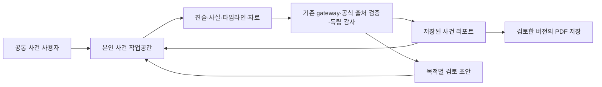

# 사건 준비 중심 전환의 아키텍처 경계

- Updated: 2026-11-08
- Status: 목표 경계와 후속 전환 조사; 제품/API/DB 변경 없음
- Decision: [ADR-0019](../adr/0019-case-preparation-without-lawyer-platform.md)
- Product: [확정 범위·검토용 흐름](../product/CASE-PREPARATION-SCOPE.md)
- Tracking: [#764](https://github.com/creno-va/baro/issues/764)

## 현재 구현과 목표를 구분한다

현재 구현에는 customer/lawyer 역할, 변호사 프로필/포트폴리오·공개 디렉터리, 관련
API·공통 client·native 경로가 존재한다. 이 문서는 해당 기능을 종료한 증거가 아니다.
새 목표는 하나의 공통 사건 사용자이며 사건의 절차/입장은 사건 맥락이다.
민사/형사 × 준비/대응은 제안 단계이고 아직 strict DTO·DB enum으로 결정하지 않았다.

화살표는 개념적 데이터/사용 흐름이다. 화면 열기나 왕복 이동이 새 모델 실행을 뜻하지 않는다.
새 provider·서비스·로펌 조직/계약 테이블·공유 권한을 추가하는 결정은 없다.

## 계정 권한과 사건 맥락

- 계정 식별자·인증 연결·본인 소유권은 유지한다. 기존 lawyer 계정도 일반 사건 기능을 이용한다.
- UI 사용자 유형 제거와 DB role 열 제거를 분리한다. role 일괄 rewrite·OAuth 재가입·계정 병합을 이번 문서 작업에서 수행하지 않는다.
- 이전 role을 세션에 가진 사용자의 로그인/재인증/동의/본인 데이터/삭제를 전환 후에도 검사한다. 과거 role이 새 공개 기능이나 관리자 권한을 부여하지 않는다.
- 분야·준비/대응·진행 단계는 소유권/인증 권한이 아니다. 입력 문서의 상대 주장으로 본인 진술·법적 지위를 자동 확정하지 않는다.
- 설치 client의 기존 strict 계약을 임의 확장/완화하지 않는다. 새 기능 계약은 사용자 기획 검토 뒤 별도 설계한다.

## 기능 종료의 후속 영향 목록

아래는 후속 구현 조사 목록이며 이 문서 작성 중 수정할 파일 목록이 아니다.

| 영역 | 현재 경계 / 후속 검토 |
| --- | --- |
| 웹 로그인·탐색 | src/pages/login.astro, components/auth 및 app-navigation·역할별 return path의 변호사 선택/진입 |
| 웹 공개/자기 프로필 | src/pages/lawyers/index.astro, lawyers/[id].astro, lawyer/index.astro 및 프로필/포트폴리오 UI |
| 대화·리포트·후속 선택 | Workspace·CaseNavigation·ReportReview·FollowUpResolution의 변호사 탐색/해결/연락 진입. 공통 사건·내보내기 유지 |
| 공개 문구 | 랜딩·help·정책 화면/초안·동의 설명·SEO의 디렉터리/연결 약속. 실제 정책 내용/버전/재동의 변경은 별도 검토 |
| 공통 계약·client | src/contracts, packages/api-client, client-core와 real/mock adapter의 role/profile/directory 계약. 구형 소비자와 종료 응답 검토 |
| native | apps/mobile의 로그인 유형·공개 목록/상세·자기 프로필·연락 진입. 설치 client의 직접 요청도 종료 목표에 포함 |
| 서버 API·공개 projection | lawyer profile/portfolio/directory router·공개 index·cursor/trigger·자산 전달 경로. 메뉴만 숨겨 완료하지 않음 |
| 인증·DB | role·profile 소유 관계·과거 동의·공개 projection·계정 삭제 FK/trigger. 정확 migration은 DB 소유 후속 이슈에서 정함 |
| R2·캐시·기존 URL | public 프로필/포트폴리오의 전달·캐시·검색 노출과 private 원본의 소유자 회수/삭제. 새 사건 파일 접근을 열지 않음 |
| 검증·운영 | 웹/native·HTTP·실제 SQL·자산/캐시·구형 client·role/session·삭제/복구 검증. 과거 성공 증거는 그대로 보존 |

## 전환 순서 제안

1. 제품 범위/문서와 기획 미결을 검토한다. 현재 단계는 여기까지다.
2. 후속 구현 지시가 있으면 최신 main/이슈와 소유자를 확인하고 계약/API·자산 종료 정책을 먼저 설계한다.
3. 기존 lawyer 사용자의 본인 데이터 이용과 계정 삭제를 유지하는 호환 경로를 검증한다.
4. 공개 목록/상세·자기 프로필 신규 작성/게시·연락·구형 직접 URL/API/공개 자산 접근을 일관되게 종료한다.
5. 이후 보관·반출·삭제 방안이 확정된 데이터만 별도 전환한다. 비공개 자산으로의 이동도 실제 경로/캐시 검증을 요구한다.
6. 같은 후보 SHA의 웹/native·실제 서버/DB·자산 회귀와 필요한 preview를 수행한다. 배포는 당시 명시 권한/기존 release 규칙을 따른다.

404/410 등 종료 응답, 구형 client 안내, 공개 캐시 정리 방법, 프로필 원본 소유자 다운로드와
삭제 방식은 아직 미결이다. 과거 데이터를 계속 공개하는 것과 소유자에게 보관하는 것을 구분한다.
기능 종료를 위한 public 접근 회수는 목표이나 이번 단계에서 실제 자산/캐시를 삭제하지 않는다.

## 리포트·초안의 일관성

기존 facts/files/summary·검증 분석·리포트 snapshot과 초안의 권한·기준 revision·CAS·
사용자 편집 보존을 재사용하는 방향으로 검토한다. 단일 가변 리포트로 과거 출력물을 덮어쓰지 않는다.
자료/요약 변경, 공식 원문 freshness, 편집, 분석 누락의 상태를 구분하는 UX를 제안한다.
다운로드는 저장된 snapshot을 사용하며 새 모델·법률 조회를 시작하지 않는 기존 경계를 유지한다.
문서 우선 intake의 0질문/사용자 확인·복합 절차·새 문서 종류는 제품 검토 뒤 계약으로 정한다.

## 보존·롤백과 인수

실제 전환 전 기존 role/소유 데이터·public/private 자산·진행 작업·삭제 journal을 내용 없이
범위/상태로 조사해야 한다. 새 계정을 만들거나 userId를 바꿔 데이터 이전을 대신하지 않는다.
문제가 생겼을 때 본인 데이터/계정 이용을 복구할 수 있어야 하며, 기능 롤백을 이유로 종료한
공개 자산/프로필을 자동 재게시하지 않는다. 구체적 전환/복구 receipt는 후속 구현에서 설계한다.

문서 단계에서는 D1/R2/API/세션/정책 receipt·원장/hold를 변경하지 않는다. 구현·삭제·전환·
실제 외부/법률 검증과 배포 완료는 각각 실제 증거가 생긴 뒤 기록한다.
