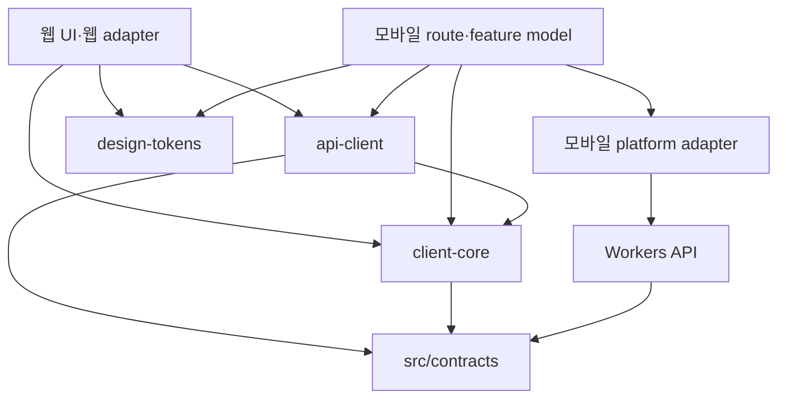

# 모바일 클라이언트와 공통 코드 구조

- Status: M1 인수; M2 프로필/자산 잔여, M3 서버 교환 통합·native credential 연결 중
- Updated: 2026-10-23
- Decision: [ADR-0017](../adr/0017-expo-mobile-and-shared-client-boundaries.md)
- Execution: [모바일 실행 계획](../development/MOBILE-EXECUTION.md), [#328](https://github.com/creno-va/baro/issues/328)
- 조사 기준: `bdc50a0af2f9adb3a6864f7cccf0983dcac771ee`; 구현 착수 때 최신 main과 대조한다.
- M1 구현 기준: PR329 병합 main `e6401de9657f8fd062fb913fe7d3945adec068fd`, [#330](https://github.com/creno-va/baro/issues/330).

## 1. 범위와 구조

iOS/Android에 기존 고객·변호사 기능을 순차 제공한다. 사건 생성·문답·요약 확인·채팅·자료·
타임라인·행동·판례·리포트·변호사 탐색/프로필·설정/삭제가 기능 목표다. 고객 핵심 흐름을
먼저 구현하되 변호사 역할과 v1 읽기/삭제를 누락한 상태를 전체 기능 완료라고 부르지 않는다.
웹 개편의 디자인이 완성되기 전에도 기본 모바일 컴포넌트로 기능과 상태를 검증한다.

초기 서버는 기존 Workers/Hono, Better Auth, D1, R2, Workflows를 재사용한다. 앱은 HTTPS
API만 호출하며 DB·R2 binding·공급자 secret·모델/법률 API에 직접 접근하지 않는다. 이 문서의
경로 중 현재 없는 것은 모두 향후 구현 목표이며 빈 패키지를 선행 생성하지 않는다.
현재 `apps/mobile`, `src/contracts`, `packages/api-client`, `packages/client-core` workspace가
존재한다. 모바일 HTTP adapter가 공개 API 목록을 연결한다. design-tokens와 인증/파일
adapter는 실제 연결 단계에서 추가한다. [앱 개발 안내](../../apps/mobile/README.md)를 따른다.

```text
baro/
├── src/
│   ├── pages/ components/ styles/ layouts/  # 기존 웹: 웹 UI 담당 유지
│   ├── client/                             # 웹 adapter·기존 facade 유지
│   ├── contracts/                          # 기존 정본, @baro/contracts 노출
│   ├── server/                             # 기존 Workers API·인증·도메인
│   └── workflows/                          # 기존 서버 실행
├── apps/mobile/
│   ├── app.config.ts                       # 환경·식별자·scheme; secret 없음
│   ├── package.json                        # Expo가 지원하는 RN/React 고정
│   └── src/
│       ├── app/                            # Expo Router route와 layout만
│       ├── features/<feature>/
│       │   ├── model/                      # hook/controller·화면 상태·사용자 명령
│       │   └── ui/                         # RN 화면 조합
│       ├── ui/                             # Button/Input/Screen/StatePanel 등
│       ├── theme/                          # 공통 토큰 → RN 스타일·폰트 매핑
│       ├── platform/                       # auth/transport/files/storage/links/
│       │                                   # lifecycle/challenge adapter
│       └── composition/                    # 실제 또는 명시적 테스트 의존성 조립
├── packages/
│   ├── api-client/                         # wire 요청·검증·오류·멱등성 계약
│   ├── client-core/                        # 순수 상태 전이·DTO 변환·선택/교정 규칙
│   └── design-tokens/                      # 의미 기반 색상·간격·타이포 값
├── tests/fixtures/                         # 기존 합성 fixture 정본
└── package.json / bun.lock                 # 점진적 workspace, 단일 lockfile
```

현재 workspace 경로는 `apps/*`, `packages/*`, `src/contracts`다. 웹 루트와 기존 실행
명령은 유지한다. 별도 workspace 도구·대규모 파일 이동은 필요가 생길 때 검토한다.
Expo는 Bun workspace와 monorepo 구성을 지원하며 기본 Metro 설정을 우선 사용한다.
[Expo monorepos](https://docs.expo.dev/guides/monorepos/)

## 2. 공유 경계와 의존성



`api-client`는 주입된 transport를 호출하고 실제 네트워크·인증·저장은 adapter가 담당한다.
위 그림의 의존성은 import 책임이며 서버 코드를 앱으로 묶는다는 뜻이 아니다.

| 경계 | 담는 내용 | 담지 않는 내용 |
| --- | --- | --- |
| `@baro/contracts` | 기존 Zod wire schema·공개 DTO·한도·버전, 명시적 export | server/db/Env·secret, 모든 내부 pipeline 계약의 일괄 공개 |
| `@baro/api-client` | operation별 path/body/response 검증, 오류 코드, revision·멱등성 요청 규칙 | React hook, 브라우저 cookie 설정, SecureStore, 환경 변수 직접 읽기 |
| `@baro/client-core` | 플랫폼 독립 view data, draft/저장본 구분, 상태 전이, 자료 선택·coverage 변환 | route 문자열, JSX, 권한의 최종 판정, 서버 도메인 로직 복제 |
| `@baro/design-tokens` | 의미 이름과 primitive 값; 웹 CSS/RN 변환의 입력 | Tailwind class, DOM style, RN 컴포넌트, 화면별 위치 배치 |
| 웹 adapter | same-origin fetch, DOM/File/Blob, browser lifecycle·다운로드 | RN·Expo 의존성 |
| 모바일 adapter | 안전한 세션 저장, native HTTP·파일 URI, 앱 수명, 로그인/링크/공유/보안 확인 | DB·공급자 직접 호출, 임의 권한 캐시 |

`src/contracts/package.json`에 클라이언트가 사용하는 v1/v2 모듈을 명시적으로 export한다.
`packages/contracts` 사본·별도 손작성 API 타입은 만들지 않는다. 기존 서버와 웹의 상대
import는 유지할 수 있다. 새 앱은 package export만 사용하고 `src/server`나
`src/client/api`를 우회 import하지 않는다. 기존 일부 view DTO가 wire 계약에서 독립된
현재 타입인 경우 먼저 그 의미를 보존해 추출하고, 구현과 다른 schema를 발명하지 않는다.

공통 세 패키지는 React-free로 시작한다. 실제 웹/앱 양쪽에서 사용하는 단위만 추출하며,
모바일 전용 hook과 navigation은 앱에 둔다. 플랫폼별 React 버전은 각 앱의 호환 조합으로
관리하고 한 앱 bundle 안에 React가 중복되지 않도록 검사한다. 모바일 도입을 위해 웹의
React 버전을 임의로 바꾸거나 모든 버전을 강제로 hoist하지 않는다.

## 3. 현재 코드에서 추출하는 순서

| 현재 경로 | 확인한 결합 | 이관 방식 |
| --- | --- | --- |
| `src/contracts/` | 이미 공유 Zod 정본 | 파일 이동 없이 workspace export·클라이언트 entry 검증 |
| `src/client/api/types.ts`, `errors.ts`, `workspace-progress.ts` | 화면 DTO·안전한 오류·상태 문구 | 순수 부분부터 client-core/API로 추출; 기존 경로 re-export 유지 |
| `src/client/api/core.ts` | `import.meta.env`, 상대 URL, same-origin cookie, mock import | 환경/transport 주입; mock은 명시적 테스트 조립으로 분리 |
| `src/client/api/workspace.ts` | 웹 facade·metadata 목록·복구 job 저장 adapter | `createWorkspaceClient`로 projection/채팅/행동/타임라인 추출; mutation/revision cache는 session instance에 격리 |
| `src/client/api/session.ts`, `src/client/auth.ts` | window/storage 이벤트, 웹 OAuth callback, sessionStorage | 웹 구현 유지; 같은 session 결과 계약을 쓰는 모바일 adapter 추가 |
| `src/client/api/cases.ts`, `challenge.ts` | 웹 facade·storage/hash·DOM challenge adapter | `packages/api-client/src/cases.ts` factory에 사건/intake와 재시도 상태를 추출, native는 동일 계약의 port를 주입 |
| `src/client/api/files.ts` | 웹 File/Blob/stream adapter | `createFilesClient`에 metadata/교정/처리/chunk 절차 추출, source/reader·hash·download IO 주입 |
| `src/client/api/reports.ts`, `src/components/reports/download.ts` | 웹 Blob/download adapter | `createReportsClient`로 생성/검토/revision·artifact 형식 검사 공유, 파일 저장/열기/공유는 플랫폼 adapter |

| `src/client/api/account.ts`, `precedents.ts` | 웹 재인증/marker·mock 조립 adapter | 사용량/삭제/freshness·판례 wire client와 session 취소를 공유 |
| `src/server/modules/lawyers/self-profile-contract.ts` | 웹도 소비하던 순수 공개 프로필 schema/DTO | `@baro/contracts/v2/self-profile` 정본으로 이동, 기존 서버 경로는 re-export; JPEG byte 처리는 기존 adapter 유지 |

각 추출 PR은 기존 import를 보존하는 facade와 필요한 기존 회귀를 포함한다. 웹 화면은
같은 동작을 유지하면서 새 공통 구현을 호출하게 한다. 웹 담당이 같은 파일을 변경 중이면
그 PR의 CI·main 병합을 먼저 확인하고 해당 모듈만 추출한다. 모든 웹 개편 종료를 선행
조건으로 요구하지 않는다. 최초 contracts export와 모바일 shell은 독립 진행할 수 있다.

## 4. 이후 UI 변경을 위한 계약

route 파일은 parameter 파싱·접근 상태 연결·screen 조합만 한다. feature model은
`state`, `data`, `draft`, `actions`를 제공하며 화면은 이를 렌더한다. wire DTO를 화면에서
직접 수정하거나 클릭 handler 안에서 fetch를 작성하지 않는다. 예를 들어 채팅 화면은
`sendMessage`, `retryMessage`, `selectAttachment`를 호출하고 revision/key/세션은 model과
client가 처리한다. 서버 거절을 UI의 `canEdit` 같은 표시값으로 우회할 수 없다.

공통 표시 상태는 loading/empty/ready/error/offline/permission/consentRequired/pending/
conflict로 정의한다. 실제 사용량 한도 상태와 비용 관측 unavailable/stale를 구분한다.
저장된 데이터가 있는 재조회 실패는 기존 내용을 유지한 채 재시도 상태를 표시한다.

기본 모바일 primitive는 Screen, Text, Button, TextField, Card, StatePanel, ConfirmDialog,
AttachmentRow로 시작한다. 한국어 입력·글자 확대·safe area·키보드·touch·screen reader를
처음부터 지원한다. 시각 마감은 뒤로 미뤄도 접근성·상태·삭제 확인은 미루지 않는다.

토큰 이름 예시는 `color.action.primary`, `color.surface.default`, `color.text.primary`,
`space.controlGap`, `radius.control`, `type.body`다. 웹의 CSS와 RN의 스타일 값은
각각 변환하며 CSS rem/폰트 확대를 숫자로 기계적으로 복제하지 않는다.

웹 개편 중 현재 시각 값은 웹 담당의 정본을 따른다. 모바일은 theme adapter 뒤에서
기본 값을 사용하고 웹 정본의 특정 commit을 기록한다. M7 전환 PR에서 합의한 값을
design-tokens 한 곳으로 옮기고 웹/RN 출력을 함께 검증한다. 그 이후 두 값 사본을
각각 수정하지 않는다. 브랜드·폰트 원본은 기존 `public/brand`, `public/fonts` 소유를
유지하고 모바일 산출물은 그 원본에서 생성·검증한다. 자산 정본 이동은 별도 조율한다.

최종 모바일 UI 수정은 feature의 `ui`, 공통 `ui`, `theme`가 중심이다. 화면 순서가
변하면 route/model 조합까지 수정할 수 있지만 API·도메인 계약 변경과 별도 PR로 다룬다.

## 5. 모바일 adapter와 먼저 검증할 기술 경계

### 인증·동의·Origin

Better Auth의 Expo server/client plugin과 SecureStore를 우선 검증한다. auth API 이외의
Hono 요청에도 같은 세션 cookie 전달과 `Set-Cookie` 갱신/만료 처리가 필요하다. 세션
캐시를 권한 정본으로 사용하지 않고 계정 전환·로그아웃·삭제에서 즉시 비운다.
[Better Auth Expo](https://better-auth.com/docs/integrations/expo),
[Expo SecureStore](https://docs.expo.dev/versions/latest/sdk/securestore/)

`src/server/api/me.ts`, `case-access.ts`, `account-delete.ts`, `src/server/auth/roles.ts`의
mutation은 현재 허용된 웹 Origin을 요구한다. Expo의 trusted scheme 추가는 이 guard를
자동 변경하지 않는다. M3에서 native cookie/header 전달을 실제 HTTP로 검증하고, 서버
세션과 mutation guard의 명시적인 native 계약을 확정한다. 단순 `Origin` 누락 허용,
CSRF 끄기, `*` CORS 허용 또는 클라이언트가 보낸 역할 헤더를 인증으로 쓰지 않는다.

OAuth는 제공자 브라우저 로그인→허용된 callback→앱 복귀를 검증한다. callback allowlist,
state/nonce·시도 식별·취소·만료·cold start/이미 열린 앱을 포함한다. 기존
`oauthAuthenticatedAt`은 실제 서버 OAuth 성공으로만 설정하고 모바일 값으로 대체하지
않는다. 고객/변호사 선택과 동의, 기존 데이터의 읽기와 재동의 후 mutation 경계를 보존한다.

M3 구현은 Better Auth1.7.7 Expo의 state proxy를 사용하되 세션 cookie를 URL에 싣는
callback hook은 one-use code 교환으로 교체한다. 앱은 SecureStore의 32-byte verifier와
시도 nonce를 먼저 만들고 S256 challenge를 callback에 묶는다. `disableRedirect: true`로
시작한 뒤 외부 브라우저를 직접 열어 복귀 code를 `/api/mobile/auth/exchange`에 제출한다.
코드는60초 만료·정확한 session/user·issuer·nonce·PKCE에 묶이며 한 번만 소비한다.
세션 cookie는 암호화된 `native-auth:v1:` 임시 metadata와 HTTPS Set-Cookie에서만 다룬다.
계정 삭제/restore replay는 owner grant를 지우고 기존 auth cron이 만료/손상 grant를 정리한다.
서버의 Origin/CSRF·OAuth freshness·기존3사/계정 연결 규칙은 유지한다. 실제 native
SecureStore/브라우저·cold/warm 복귀와 동의/역할 UI는 #346에서 후속 연결·인수한다.

### Turnstile

새 사건 생성에 필요한 Turnstile은 native JS만으로 실행할 수 없다. BARO의 제한된 HTTPS
challenge 페이지를 WebView로 여는 adapter를 검증한다. 앱은 허용된 페이지의 결과만 받고
서버는 기존 siteverify를 수행한다. navigation/메시지 출처·시도 대응·토큰 만료/재사용·취소를
검사하고 토큰을 로그·영속 초안에 저장하지 않는다. 웹 전체를 WebView로 감싸지 않는다.
실제 구현은 기존 built CSP를 유지하는 방식으로 검증한다.
[Cloudflare 모바일 구현](https://developers.cloudflare.com/turnstile/get-started/mobile-implementation/)

### 파일·리포트

공유 파일 식별은 name/mediaType/byteLength와 opaque source handle을 사용한다. browser
File과 native URI는 adapter 내부에 둔다. 기존 예약·part·contentHash·commit 계약과 상한을
재사용하며 대용량을 base64/전체 ArrayBuffer로 메모리에 올리지 않는다. native byte 범위
읽기와 incremental hash 가능 여부를 먼저 실측한다. 미지원 크기를 성공으로 표시하거나
상한을 조용히 낮추지 않고 재현 결과와 사용자 안내를 남긴다.

처리는 서버에서 계속되고, 앱 복귀 시 upload/job 상태를 재조회한다. 사용자 재시도와
중복 실행을 구분하며 같은 작업의 key를 유지한다. 앱이 백그라운드에서도 계속 전송된다고
가정하지 않는다. OS가 파일 URI 접근을 철회한 경우 재선택·검증 경로를 제공한다.

PDF는 서버가 생성한 검증된 결과를 내려받아 열기/공유한다. 임시 파일은 앱 private cache에
두고 취소·만료·계정 전환·다음 시작 시 정리한다. 사용자 요청으로 외부 앱에 전달된 복사본은
서버 삭제로 회수된다고 표시하지 않는다. 앱이 임의로 공개 URL을 발급하지 않는다.

### 상태·초안·앱 수명

앱 시작/foreground에서 세션과 현재 작업을 재검증한다. background에서는 polling을 멈추고
진행 중 응답이 늦게 돌아와 새 계정 상태를 덮지 않도록 session generation을 확인한다.
cache와 mutation key는 owner/session/case/operation 단위이며 로그아웃·전환 때 요청을
취소하고 이전 owner의 상태를 제거한다. 같은 key와 다른 body의 재전송은 금지한다.

초기에는 서버에 저장된 진행 상태를 복원하고 offline mutation queue는 도입하지 않는다.
화면 재배치/일시 장애 중 입력은 메모리에 보존하며 강제 종료 시 미저장 입력의 손실을
사용자에게 명확히 알린다. 사건 원문을 AsyncStorage 등에 평문 영속화하지 않는다. 강제
종료 후에도 미저장 초안 보존을 지원하려면 암호화·보관·삭제 계약을 별도 인수한 뒤 추가한다.

## 6. 버전·환경·소유권

API base URL, 앱 scheme·bundle/package ID는 local/preview/production을 분리한다.
`EXPO_PUBLIC_*`와 앱 binary에는 공개 설정만 넣는다. runtime config를 화면에서 직접
읽지 않고 composition에서 검증해 주입한다. production에 test adapter나 합성 계정을
자동 fallback으로 넣지 않는다.

서버 응답에 필드를 추가해도 현재 strict Zod 소비자가 거절할 수 있으므로 새/이전 앱
계약 fixture를 모두 검사한다. 지원 중인 앱 build와 API 계약 버전을 표로 유지하고
breaking change는 기존 경로 유지 또는 명시적 새 버전으로 다룬다. 앱 배포와 동시에
이전 API를 제거하지 않는다. 호환성 검사는 서버 배포 전에 수행한다.

| 소유 영역 | 담당 | 통합 규칙 |
| --- | --- | --- |
| 웹 화면·스타일·layout | 기존 웹 UI 채팅 | 모바일 작업에서 일괄 이동/재작성하지 않음 |
| 앱 route/feature/ui/platform | 모바일 담당 | `apps/mobile/**`에서 독립 구현 |
| 계약·공통 패키지·root package/lock/CI | 공유 기반 PR 담당 한 곳 | 먼저 main 병합 후 소비; 개별 작업자가 동시에 lock 수정하지 않음 |
| 인증/Origin/동의/Turnstile | 기존 인증·API 담당 + 모바일 연결 PR | guard 회귀와 실기기 증거 구분 |
| 업로드/리포트 API·서버 저장소 | 기존 자료 담당 | API 의미 변경은 해당 담당 PR, mobile IO는 앱 담당 |
| 시각 토큰·브랜드 | 웹 디자인 정본 담당 + 모바일 theme 담당 | 토큰 값 인계 commit과 단일 정본 전환 PR 기록 |
| schema/migration | 기존 DB 담당 | 모바일 이유만으로 DB 재설계·번호 할당하지 않음 |

자동 에이전트/채팅/스케줄은 만들지 않는다. 다른 채팅에 메시지를 보낼 때는 사용자의
명시적 전달 지시를 따른다. 이 문서·PR의 소유권 표를 공통 인계 자료로 사용한다.
