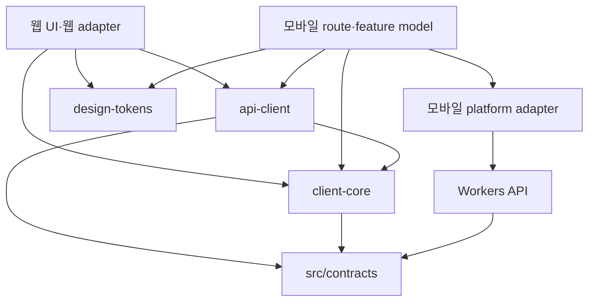

# 모바일 클라이언트와 공통 코드 구조

- Status: M1/M2 인수; M3 실제 인증 잔여, M4 고객 사건/작업공간 연결 중
- Updated: 2026-10-23
- Decision: [ADR-0017](../adr/0017-expo-mobile-and-shared-client-boundaries.md)
- Execution: [모바일 실행 계획](../development/MOBILE-EXECUTION.md), [#328](https://github.com/creno-va/baro/issues/328)
- 조사 기준: `bdc50a0af2f9adb3a6864f7cccf0983dcac771ee`; 구현 착수 때 최신 main과 대조한다.
- M1 구현 기준: PR329 병합 main `e6401de9657f8fd062fb913fe7d3945adec068fd`, [#330](https://github.com/creno-va/baro/issues/330).

## 1. 범위와 구조

iOS/Android에 기존 고객·변호사 기능을 순차 제공한다. 사건 생성·문답·요약 확인·채팅·자료·
타임라인·행동·판례·리포트·변호사 탐색/프로필·설정/삭제가 기능 목표다. 고객 핵심 흐름을
먼저 구현하되 변호사 역할과 v1 읽기/삭제를 누락한 상태를 전체 기능 완료라고 부르지 않는다.
웹 개편의 디자인이 완성되기 전에도 기본 모바일 컴포넌트로 기능과 상태를 검증한다.

초기 서버는 기존 Workers/Hono, Better Auth, D1, R2, Workflows를 재사용한다. 앱은 HTTPS
API만 호출하며 DB·R2 binding·공급자 secret·모델/법률 API에 직접 접근하지 않는다. 이 문서의
경로 중 현재 없는 것은 모두 향후 구현 목표이며 빈 패키지를 선행 생성하지 않는다.
현재 `apps/mobile`, `src/contracts`, `packages/api-client`, `packages/client-core` workspace가
존재한다. 모바일 HTTP adapter가 공개 API 목록을 연결한다. design-tokens와 인증/파일
adapter는 실제 연결 단계에서 추가한다. [앱 개발 안내](../../apps/mobile/README.md)를 따른다.

```text
baro/
├── src/
│   ├── pages/ components/ styles/ layouts/  # 기존 웹: 웹 UI 담당 유지
│   ├── client/                             # 웹 adapter·기존 facade 유지
│   ├── contracts/                          # 기존 정본, @baro/contracts 노출
│   ├── server/                             # 기존 Workers API·인증·도메인
│   └── workflows/                          # 기존 서버 실행
├── apps/mobile/
│   ├── app.config.ts                       # 환경·식별자·scheme; secret 없음
│   ├── package.json                        # Expo가 지원하는 RN/React 고정
│   └── src/
│       ├── app/                            # Expo Router route와 layout만
│       ├── features/<feature>/
│       │   ├── model/                      # hook/controller·화면 상태·사용자 명령
│       │   └── ui/                         # RN 화면 조합
│       ├── ui/                             # Button/Input/Screen/StatePanel 등
│       ├── theme/                          # 공통 토큰 → RN 스타일·폰트 매핑
│       ├── platform/                       # auth/transport/files/storage/links/
│       │                                   # lifecycle/challenge adapter
│       └── composition/                    # 실제 또는 명시적 테스트 의존성 조립
├── packages/
│   ├── api-client/                         # wire 요청·검증·오류·멱등성 계약
│   ├── client-core/                        # 순수 상태 전이·DTO 변환·선택/교정 규칙
│   └── design-tokens/                      # 의미 기반 색상·간격·타이포 값
├── tests/fixtures/                         # 기존 합성 fixture 정본
└── package.json / bun.lock                 # 점진적 workspace, 단일 lockfile
```

현재 workspace 경로는 `apps/*`, `packages/*`, `src/contracts`다. 웹 루트와 기존 실행
명령은 유지한다. 별도 workspace 도구·대규모 파일 이동은 필요가 생길 때 검토한다.
Expo는 Bun workspace와 monorepo 구성을 지원하며 기본 Metro 설정을 우선 사용한다.
[Expo monorepos](https://docs.expo.dev/guides/monorepos/)

## 2. 공유 경계와 의존성



`api-client`는 주입된 transport를 호출하고 실제 네트워크·인증·저장은 adapter가 담당한다.
위 그림의 의존성은 import 책임이며 서버 코드를 앱으로 묶는다는 뜻이 아니다.

| 경계 | 담는 내용 | 담지 않는 내용 |
| --- | --- | --- |
| `@baro/contracts` | 기존 Zod wire schema·공개 DTO·한도·버전, 명시적 export | server/db/Env·secret, 모든 내부 pipeline 계약의 일괄 공개 |
| `@baro/api-client` | operation별 path/body/response 검증, 오류 코드, revision·멱등성 요청 규칙 | React hook, 브라우저 cookie 설정, SecureStore, 환경 변수 직접 읽기 |
| `@baro/client-core` | 플랫폼 독립 view data, draft/저장본 구분, 상태 전이, 자료 선택·coverage 변환 | route 문자열, JSX, 권한의 최종 판정, 서버 도메인 로직 복제 |
| `@baro/design-tokens` | 의미 이름과 primitive 값; 웹 CSS/RN 변환의 입력 | Tailwind class, DOM style, RN 컴포넌트, 화면별 위치 배치 |
| 웹 adapter | same-origin fetch, DOM/File/Blob, browser lifecycle·다운로드 | RN·Expo 의존성 |
| 모바일 adapter | 안전한 세션 저장, native HTTP·파일 URI, 앱 수명, 로그인/링크/공유/보안 확인 | DB·공급자 직접 호출, 임의 권한 캐시 |

`src/contracts/package.json`에 클라이언트가 사용하는 v1/v2 모듈을 명시적으로 export한다.
`packages/contracts` 사본·별도 손작성 API 타입은 만들지 않는다. 기존 서버와 웹의 상대
import는 유지할 수 있다. 새 앱은 package export만 사용하고 `src/server`나
`src/client/api`를 우회 import하지 않는다. 기존 일부 view DTO가 wire 계약에서 독립된
현재 타입인 경우 먼저 그 의미를 보존해 추출하고, 구현과 다른 schema를 발명하지 않는다.

공통 세 패키지는 React-free로 시작한다. 실제 웹/앱 양쪽에서 사용하는 단위만 추출하며,
모바일 전용 hook과 navigation은 앱에 둔다. 플랫폼별 React 버전은 각 앱의 호환 조합으로
관리하고 한 앱 bundle 안에 React가 중복되지 않도록 검사한다. 모바일 도입을 위해 웹의
React 버전을 임의로 바꾸거나 모든 버전을 강제로 hoist하지 않는다.

## 3. 현재 코드에서 추출하는 순서

| 현재 경로 | 확인한 결합 | 이관 방식 |
| --- | --- | --- |
| `src/contracts/` | 이미 공유 Zod 정본 | 파일 이동 없이 workspace export·클라이언트 entry 검증 |
| `src/client/api/types.ts`, `errors.ts`, `workspace-progress.ts` | 화면 DTO·안전한 오류·상태 문구 | 순수 부분부터 client-core/API로 추출; 기존 경로 re-export 유지 |
| `src/client/api/core.ts` | `import.meta.env`, 상대 URL, same-origin cookie, mock import | 환경/transport 주입; mock은 명시적 테스트 조립으로 분리 |
| `src/client/api/workspace.ts` | 웹 facade·metadata 목록·복구 job 저장 adapter | `createWorkspaceClient`로 projection/채팅/행동/타임라인 추출; mutation/revision cache는 session instance에 격리 |
| `src/client/api/session.ts`, `src/client/auth.ts` | window/storage 이벤트, 웹 OAuth callback, sessionStorage | 웹 구현 유지; 같은 session 결과 계약을 쓰는 모바일 adapter 추가 |
| `src/client/api/cases.ts`, `challenge.ts` | 웹 facade·storage/hash·DOM challenge adapter | `packages/api-client/src/cases.ts` factory에 사건/intake와 재시도 상태를 추출, native는 동일 계약의 port를 주입 |
| `src/client/api/files.ts` | 웹 File/Blob/stream adapter | `createFilesClient`에 metadata/교정/처리/chunk 절차 추출, source/reader·hash·download IO 주입 |
| `src/client/api/reports.ts`, `src/components/reports/download.ts` | 웹 Blob/download adapter | `createReportsClient`로 생성/검토/revision·artifact 형식 검사 공유, 파일 저장/열기/공유는 플랫폼 adapter |

| `src/client/api/account.ts`, `precedents.ts` | 웹 재인증/marker·mock 조립 adapter | 사용량/삭제/freshness·판례 wire client와 session 취소를 공유 |
| `src/server/modules/lawyers/self-profile-contract.ts` | 웹도 소비하던 순수 공개 프로필 schema/DTO | `@baro/contracts/v2/self-profile` 정본으로 이동, 기존 서버 경로는 re-export; JPEG byte 처리는 기존 adapter 유지 |
| `src/client/api/lawyers.ts` | 기존 File/Blob·hash·sessionStorage/mock facade | `createLawyersClient`·`createLawyerAssetsClient`로 프로필/공개 전환·자산 목록/삭제·예약/원본·재시도 공유; immutable source/read/upload/download/storage port 주입 |


각 추출 PR은 기존 import를 보존하는 facade와 필요한 기존 회귀를 포함한다. 웹 화면은
같은 동작을 유지하면서 새 공통 구현을 호출하게 한다. 웹 담당이 같은 파일을 변경 중이면
그 PR의 CI·main 병합을 먼저 확인하고 해당 모듈만 추출한다. 모든 웹 개편 종료를 선행
조건으로 요구하지 않는다. 최초 contracts export와 모바일 shell은 독립 진행할 수 있다.

## 4. 이후 UI 변경을 위한 계약

route 파일은 parameter 파싱·접근 상태 연결·screen 조합만 한다. feature model은
`state`, `data`, `draft`, `actions`를 제공하며 화면은 이를 렌더한다. wire DTO를 화면에서
직접 수정하거나 클릭 handler 안에서 fetch를 작성하지 않는다. 예를 들어 채팅 화면은
`sendMessage`, `retryMessage`, `selectAttachment`를 호출하고 revision/key/세션은 model과
client가 처리한다. 서버 거절을 UI의 `canEdit` 같은 표시값으로 우회할 수 없다.

공통 표시 상태는 loading/empty/ready/error/offline/permission/consentRequired/pending/
conflict로 정의한다. 실제 사용량 한도 상태와 비용 관측 unavailable/stale를 구분한다.
저장된 데이터가 있는 재조회 실패는 기존 내용을 유지한 채 재시도 상태를 표시한다.

기본 모바일 primitive는 Screen, Text, Button, TextField, Card, StatePanel, ConfirmDialog,
AttachmentRow로 시작한다. 한국어 입력·글자 확대·safe area·키보드·touch·screen reader를
처음부터 지원한다. 시각 마감은 뒤로 미뤄도 접근성·상태·삭제 확인은 미루지 않는다.

토큰 이름 예시는 `color.action.primary`, `color.surface.default`, `color.text.primary`,
`space.controlGap`, `radius.control`, `type.body`다. 웹의 CSS와 RN의 스타일 값은
각각 변환하며 CSS rem/폰트 확대를 숫자로 기계적으로 복제하지 않는다.

웹 개편 중 현재 시각 값은 웹 담당의 정본을 따른다. 모바일은 theme adapter 뒤에서
기본 값을 사용하고 웹 정본의 특정 commit을 기록한다. M7 전환 PR에서 합의한 값을
design-tokens 한 곳으로 옮기고 웹/RN 출력을 함께 검증한다. 그 이후 두 값 사본을
각각 수정하지 않는다. 브랜드·폰트 원본은 기존 `public/brand`, `public/fonts` 소유를
유지하고 모바일 산출물은 그 원본에서 생성·검증한다. 자산 정본 이동은 별도 조율한다.

최종 모바일 UI 수정은 feature의 `ui`, 공통 `ui`, `theme`가 중심이다. 화면 순서가
변하면 route/model 조합까지 수정할 수 있지만 API·도메인 계약 변경과 별도 PR로 다룬다.

## 5. 모바일 adapter와 먼저 검증할 기술 경계

### 인증·동의·Origin

Better Auth의 Expo server/client plugin과 SecureStore를 우선 검증한다. auth API 이외의
Hono 요청에도 같은 세션 cookie 전달과 `Set-Cookie` 갱신/만료 처리가 필요하다. 세션
캐시를 권한 정본으로 사용하지 않고 계정 전환·로그아웃·삭제에서 즉시 비운다.
[Better Auth Expo](https://better-auth.com/docs/integrations/expo),
[Expo SecureStore](https://docs.expo.dev/versions/latest/sdk/securestore/)

`src/server/api/me.ts`, `case-access.ts`, `account-delete.ts`, `src/server/auth/roles.ts`의
mutation은 현재 허용된 웹 Origin을 요구한다. Expo의 trusted scheme 추가는 이 guard를
자동 변경하지 않는다. M3에서 native cookie/header 전달을 실제 HTTP로 검증하고, 서버
세션과 mutation guard의 명시적인 native 계약을 확정한다. 단순 `Origin` 누락 허용,
CSRF 끄기, `*` CORS 허용 또는 클라이언트가 보낸 역할 헤더를 인증으로 쓰지 않는다.

OAuth는 제공자 브라우저 로그인→허용된 callback→앱 복귀를 검증한다. callback allowlist,
state/nonce·시도 식별·취소·만료·cold start/이미 열린 앱을 포함한다. 기존
`oauthAuthenticatedAt`은 실제 서버 OAuth 성공으로만 설정하고 모바일 값으로 대체하지
않는다. 고객/변호사 선택과 동의, 기존 데이터의 읽기와 재동의 후 mutation 경계를 보존한다.

M3 구현은 Better Auth1.7.7 Expo의 state proxy를 사용하되 세션 cookie를 URL에 싣는
callback hook은 one-use code 교환으로 교체한다. 앱은 SecureStore의 32-byte verifier와
시도 nonce를 먼저 만들고 S256 challenge를 callback에 묶는다. `disableRedirect: true`로
시작한 뒤 외부 브라우저를 직접 열어 복귀 code를 `/api/mobile/auth/exchange`에 제출한다.
코드는60초 만료·정확한 session/user·issuer·nonce·PKCE에 묶이며 한 번만 소비한다.
세션 cookie는 암호화된 `native-auth:v1:` 임시 metadata와 HTTPS Set-Cookie에서만 다룬다.
계정 삭제/restore replay는 owner grant를 지우고 기존 auth cron이 만료/손상 grant를 정리한다.
서버의 Origin/CSRF·OAuth freshness·기존3사/계정 연결 규칙은 유지한다. 실제 native
SecureStore/브라우저·cold/warm 복귀와 동의/역할 UI는 PR348·349·351에 통합했다.
reauth의 서버 선행은 signed 기존 세션의 `/api/mobile/auth/reauth/prepare`, callback의
선택적 `purpose=reauthenticate`, signed 새 세션의 `/api/mobile/auth/reauth/verify`다.
준비는 기존 연결 provider·원래 session/user·nonce/challenge와10분 TTL에 묶어 별도 암호화
namespace `native-reauth:v1:`에 보관한다. callback은 같은 owner의 실제 새 OAuth 세션만
인정하고 교환도 purpose/원래 owner를 대조한다. 기존 쿠키가 남았거나 recentOAuth라는
이유만으로 재인증 성공으로 보지 않으며 verify가 같은 nonce/verifier와 정확한 새 세션을
확인한다. 서버 선행 PR359는 main `6f79774`와 head CI39847136702에 통합했다.

네이티브 재인증은 기존 cookie를 보존하고 연결된 provider만 선택한다. 준비 receipt와
nonce/verifier는 `.auth` SecureStore에 필수 저장/readback한 뒤 브라우저를 연다. 복귀는
purpose를 포함한 교환·서버 verify·같은 owner의 fresh 세션 확인을 모두 거쳐야 성공한다.
역할을 다시 쓰지 않는다. cookie 저장 뒤 응답 유실·proof 쓰기 실패·cold 재개는 정확한
새 세션의 proof로만 복구하며 이전 세션이 로그인됐다는 이유로 성공하지 않는다.
완료 marker는 ownerTag/startedAt/attemptId만 저장하고 민감 작업 권한은 서버의 fresh
access 응답과 공통 account client가 결정한다. 취소는 기존 로그인을 유지하지만 명시적
로그아웃은 pending/marker/cookie를 지우며 `.case-operations`는 보존한다. 동의 전에도
재인증은 가능하고 조회 실패는 일반 계정 사용을 막지 않는다. 합성 Hono/SQL·RN 화면
검증과 실제 제공자/기기 인수는 구분하며 후자는 #346에 남긴다.

### Turnstile

새 사건 생성에 필요한 Turnstile은 native JS만으로 실행할 수 없다. BARO의 제한된 HTTPS
challenge 페이지를 WebView로 여는 adapter를 검증한다. 앱은 허용된 페이지의 결과만 받고
서버는 기존 siteverify를 수행한다. navigation/메시지 출처·시도 대응·토큰 만료/재사용·취소를
검사하고 토큰을 로그·영속 초안에 저장하지 않는다. 웹 전체를 WebView로 감싸지 않는다.
Hono의 `/api/mobile/challenge?attemptId=UUID`는 공개 sitekey로 위젯만 렌더하며 auth
cookie·개인 입력을 읽지 않는다. 응답별 nonce CSP를 쓰고 Astro의 기존 CSP/화면은 바꾸지
않는다. bridge의 32바이트 비밀값은 native의 상위 frame 주입 이후에만 메시지에 포함되며
시도/현재 URL/scope와 함께 검사한다. Android는 frame flag 누락·origin만 반환·상위 URL을
대신 반환하는 메시지 경로가 있으므로 URL만으로 신뢰하지 않는다.

WebView의 origin whitelist 불일치는 자체 guard 전에 Linking을 호출하므로 `[*]`로 모든
이동을 guard에 보내고, guard에서 고정 페이지·Cloudflare iframe·필요한 about frame만
허용한다. 상위 이동은 canonical 페이지만 허용하고 Android의 frame 정보 누락 시에는
상위 URL 변경에서 닫는다. 주입 script 자체도 정확한 현재 URL을 확인한다. auth cookie는
공유하지 않고 파일 접근·혼합 콘텐츠·팝업/다운로드를 허용하지 않는다. 라이브러리 실제
navigation helper와 RN host, 제품 HTML/CSP 브라우저 검증을 각각 유지한다.
[Cloudflare 모바일 구현](https://developers.cloudflare.com/turnstile/get-started/mobile-implementation/)

### 파일·리포트

공유 파일 식별은 name/mediaType/byteLength와 opaque source handle을 사용한다. browser
File과 native URI는 adapter 내부에 둔다. 기존 예약·part·contentHash·commit 계약과 상한을
재사용하며 대용량을 base64/전체 ArrayBuffer로 메모리에 올리지 않는다. native byte 범위
읽기와 incremental hash 가능 여부를 먼저 실측한다. 미지원 크기를 성공으로 표시하거나
상한을 조용히 낮추지 않고 재현 결과와 사용자 안내를 남긴다.

M5 #361의 `getNativeUploadSources()`는 SDK58 DocumentPicker58.0.4의 cache copy를 앱 전용
임의 ID 경로로 옮긴다. source 객체에는 name/size/type만 노출하며 실제 URI는 adapter에
보관한다. 읽기 handle은 `FileMode.ReadOnly`, 단일 native read는256KiB 이하다. noble
SHA2562.4.0을 점진적으로 계산하고 서버의8MiB 조각마다 hash를 보관해 실제 part의 hash와
다시 대조한다. 같은 길이로 내용이 바뀐 경우도 전송 body를 반환하지 않는다. 부분 읽기는
모으되 빈/과잉/잘못된 offset과 크기 변경을 거절하며 모든 handle은 finally에서 닫는다.
close/abort는 진행 중/대기 part를 폐기한다. snapshot은 명시적 release/clear에서 reader를
먼저 닫고 삭제한다. 삭제 실패는 다음 정리까지 보존하며 첫 사용 시 자기 namespace의
고아 cache만 정리한다. source를 URI 문자열이나 새 metadata 객체로 복제해 재사용할 수 없다.

2026-10-23 합성 로컬 파일 port 실측은100,000,000·1,000,000,000bytes에서 독립 Node SHA256과
전체 fingerprint/조각 재결합이 일치했다. 최대 read262,144bytes·part8,388,608bytes,
handle13/13·121/121 open/close, 각각951ms·10,059ms였다. 이는 실제 디스크를 읽은 로컬 port
측정이며 native SDK의 기기 성능·메모리/URI 권한 인수가 아니다. OS picker의 cache copy는
JS 바깥에서 수행되므로 큰 파일 복사/공간 부족과 취소 정리는 두 OS에서 추가 인수한다.
native `/files`는 이 source와 recovery를 조립해 업로드/검토·원본 저장에 연결한다. 리포트 UI와
실제 기기 IO/메모리 인수는 M5 후속이다.
`bun scripts/mobile-file-io-probe.ts --large`로 위 합성 디스크 검사를 수동 재현하며 CI의
빠른 검사에서는1GB 파일을 생성하지 않는다.

공통 files client의 선택적 `recovery`는 owner/path/정규화된 예약 입력의 SHA256으로 작업을
식별한다. `.case-operations`의 `baro-upload-operation:<hash>` 값은 version·예약 UUID/원래
revision·서버 file ID·완료 UUID/원래 revision·완료 입력 hash·확인된 충돌 상태만 허용한다.
파일 이름/URI·업로드 세션 token·manifest/사실/본문은 저장하지 않는다. 입장 전 required
write/readback, 예약 ACK 뒤 file ID 저장, 완료 전 CAS/key 저장을 검사한다. 새 client는 원래
키/본문/revision으로 예약을 복구하고 signed upload-session을 다시 읽으며 bytes를 재선택해
검증한다. 같은 in-flight 작업은 storage 단위로 공유하고 모든 IO/반환은 generation을 확인한다.

완료 응답 유실 뒤에는 저장된 정확한 file ID의 signed 상태를 읽는다. 이름/크기로 다른
파일을 골라 성공으로 보지 않으며 최종 metadata가 provisional hash를 manifest로 옮기는
서버 의미를 유지한다. ACK callback과 후속 목록 조회를 구분하고 확정 조회 뒤 cleanup 실패는
접수를 실패로 바꾸지 않는다. ordinary retry는 CAS를 갱신하지 않는다. `resolveConflict: true`는
확인된409·만료 session/예약의404·정확한 원래 파일의404 이후 사용자 명시적 결정에만 쓴다.
역할/owner/동의 오류나 목록 누락만으로 새 예약을 만들지 않는다. 이전 서버 예약·원장·hold를
지우지 않고 만료/삭제 정리는 기존 서버가 담당한다. native files 화면은 같은 계약을 소비하고
background 확인 중 source만 같은 fresh owner/권한에 복원하며 화면 이탈에서는 버린다.

예약 응답/file ID 저장 유실 뒤 다른 signed client가 같은 pending 파일을 완료한 경우에도,
서버는 원래 owner/key/request hash의 예약 replay에서 finalized file ID를 돌려준다. 기존
session DTO와 만료 시각은 보존하며 lease를 다시 열거나 연장하지 않는다. resume/part 쓰기는
기존 open·만료·동의 guard를 그대로 검사하고 삭제된 파일·다른 owner/본문은 복구하지 않는다.
완료된 파일의 오래된 예약을 새 admission으로 해석해 중복 저장하지 않는다.

처리는 서버에서 계속되고, 앱 복귀 시 upload/job 상태를 재조회한다. 사용자 재시도와
중복 실행을 구분하며 같은 작업의 key를 유지한다. 앱이 백그라운드에서도 계속 전송된다고
가정하지 않는다. OS가 파일 URI 접근을 철회한 경우 재선택·검증 경로를 제공한다.

PDF는 서버가 생성한 검증된 결과를 내려받아 열기/공유한다. 임시 파일은 앱 private cache에
두고 취소·만료·계정 전환·다음 시작 시 정리한다. 사용자 요청으로 외부 앱에 전달된 복사본은
서버 삭제로 회수된다고 표시하지 않는다. 앱이 임의로 공개 URL을 발급하지 않는다.

`createNativeFiles`는 실제 `expo/fetch`와 sealed cookie writer를 공유한다. 네이티브 SDK의
redirect:error·credentials:omit을 사용하고 모든 요청/응답을 owner hint·generation으로
검사한다. 원본 response body는 private 무작위 파일에 최대256KiB write로 순차 기록하며
전체 binary arrayBuffer/blob/base64 변환을 하지 않는다. 전송 압축은 decoded byte 수로
상한을 적용하고 길이/디스크 크기와 네트워크/디스크 재읽기의 증분 SHA256을 대조한다.
URI는 adapter에만 두고
opaque handle의 명시적 preview/share 직전에도 owner를 재검사한다. SDK의 native buffer·
실제 기기 메모리는 이 JS write 상한으로 증명되지 않으므로 별도 인수한다.

startup·로그아웃/계정/역할/동의 변경·화면 이탈에서는 source/download cache를 폐기하고
진행 중 IO/preview가 끝난 뒤 파일을 삭제한다. background checking은 개인 화면만 숨기고,
이미 native handoff를 시작한 파일은 외부 앱이 읽는 동안 유지한 뒤 복귀 시 정리한다.
정리 실패는 파일 기능에서 재시도하고 공개 탐색/로그인을 막지 않으며 미해결 작업 key는
지우지 않는다. `.auth`·`.case-operations` SecureStore와 plaintext private cache는 별개다.
순수 모델의 NativeUploadSource 타입은 Expo SDK import와 분리해 Workers/DOM 전역 타입이
계약 검사에 섞이지 않도록 한다. Node 타입은 Jest 테스트 설정에만 추가했다.

파일 검토는 coverage를100개씩 교체 표시하고 관찰은 서버 cursor의 앞/뒤 페이지로 탐색한다.
다른 revision의 페이지를 섞지 않으며 전체 관찰을 누적 렌더하지 않는다. 단일 관찰의 원문/
교정·위치·불확실성/제외와 서버의 미완료 교정 이어가기/중단을 제공한다. 미저장 교정은
background/이탈 시 버리고 서버 저장분을 다시 읽는다. 동의 갱신 전에도 기존 자료의 읽기·
원본 저장·삭제는 가능하고 업로드/처리/교정은 최신 동의가 필요하다.

### 상태·초안·앱 수명

앱 시작/foreground에서 세션과 현재 작업을 재검증한다. background에서는 polling을 멈추고
진행 중 응답이 늦게 돌아와 새 계정 상태를 덮지 않도록 session generation을 확인한다.
cache와 mutation key는 owner/session/case/operation 단위이며 로그아웃·전환 때 요청을
취소하고 이전 owner의 상태를 제거한다. 같은 key와 다른 body의 재전송은 금지한다.

초기에는 서버에 저장된 진행 상태를 복원하고 offline mutation queue는 도입하지 않는다.
화면 재배치/일시 장애 중 입력은 메모리에 보존하며 강제 종료 시 미저장 입력의 손실을
사용자에게 명확히 알린다. 사건 원문을 AsyncStorage 등에 평문 영속화하지 않는다. 강제
종료 후에도 미저장 초안 보존을 지원하려면 암호화·보관·삭제 계약을 별도 인수한 뒤 추가한다.

## 6. 버전·환경·소유권

API base URL, 앱 scheme·bundle/package ID는 local/preview/production을 분리한다.
`EXPO_PUBLIC_*`와 앱 binary에는 공개 설정만 넣는다. runtime config를 화면에서 직접
읽지 않고 composition에서 검증해 주입한다. production에 test adapter나 합성 계정을
자동 fallback으로 넣지 않는다.

서버 응답에 필드를 추가해도 현재 strict Zod 소비자가 거절할 수 있으므로 새/이전 앱
계약 fixture를 모두 검사한다. 지원 중인 앱 build와 API 계약 버전을 표로 유지하고
breaking change는 기존 경로 유지 또는 명시적 새 버전으로 다룬다. 앱 배포와 동시에
이전 API를 제거하지 않는다. 호환성 검사는 서버 배포 전에 수행한다.

| 소유 영역 | 담당 | 통합 규칙 |
| --- | --- | --- |
| 웹 화면·스타일·layout | 기존 웹 UI 채팅 | 모바일 작업에서 일괄 이동/재작성하지 않음 |
| 앱 route/feature/ui/platform | 모바일 담당 | `apps/mobile/**`에서 독립 구현 |
| 계약·공통 패키지·root package/lock/CI | 공유 기반 PR 담당 한 곳 | 먼저 main 병합 후 소비; 개별 작업자가 동시에 lock 수정하지 않음 |
| 인증/Origin/동의/Turnstile | 기존 인증·API 담당 + 모바일 연결 PR | guard 회귀와 실기기 증거 구분 |
| 업로드/리포트 API·서버 저장소 | 기존 자료 담당 | API 의미 변경은 해당 담당 PR, mobile IO는 앱 담당 |
| 시각 토큰·브랜드 | 웹 디자인 정본 담당 + 모바일 theme 담당 | 토큰 값 인계 commit과 단일 정본 전환 PR 기록 |
| schema/migration | 기존 DB 담당 | 모바일 이유만으로 DB 재설계·번호 할당하지 않음 |

자동 에이전트/채팅/스케줄은 만들지 않는다. 다른 채팅에 메시지를 보낼 때는 사용자의
명시적 전달 지시를 따른다. 이 문서·PR의 소유권 표를 공통 인계 자료로 사용한다.

### 네이티브 리포트 요청 복구

공통 reports client의 `recovery`는 native opt-in이다. 저장과 새 초안 생성은 화면에서
확인한 명시적 report revision을 요구한다. 첫 초안이 아직 없을 때만 생성에 `null`을
명시해 absence CAS를 사용하며 기존 리포트가 생겼다면 서버가 거절한다. owner·경로·method·정확한 body의 해시로
SecureStore의 불투명 UUID를 찾는다. 응답 유실/재생성 뒤 같은 입력·원래 revision의
명시적 재시도는 같은 key를 사용하고, metadata GET으로 이미 전송한 basis를 바꾸지 않는다.
본문·마스킹·사진/자료 선택·URI·token은 복구 저장소에 기록하지 않는다.

검증된 저장/생성 응답을 받으면 key를 정리한다. 정리 실패는 성공 응답을 실패로 바꾸지
않고 기존 key를 남긴다. ZIP은 immutable report ID와 정확한 원본 선택별 key를 유지해
재다운로드/재시작에도 같은 패키지를 조회한다. 저장소 잠김·silent write 손실·오염은
새 쓰기 전송을 막고, auth reset은 미확정 key를 삭제하지 않는다. 기존 workspace와
prepare/complete 잠금을 공유하되 `baro-reports-request:<hash>` namespace로 분리한다.
기본 웹 facade/wire에는 이 opt-in을 적용하지 않는다.

### 리포트 소비 화면

네이티브 reports 모델은 서버 저장본과 편집 draft를 분리하고, 원래 report revision으로
저장·새 초안을 요청한다. 본문/자료 제외가 함께 바뀌면 먼저 본문을 저장하고 제외 선택을
남겨 다음 저장에서 출처로 재구성한다. 성공 ACK 뒤 검토 확인을 해제하며 충돌/응답 유실은
편집을 보존한다. 초기 기술 한도는 파일 metadata를 읽고 사용자가 제외할 자료를 고른 뒤
명시적 null intent로 복구한다. 전체 자료/본문을 축약해 한도를 우회하지 않는다.

PDF·HTML·ZIP은 실제 sealed expo/fetch→private streamed cache·독립 readback SHA256과
공통 artifact signature/HTML marker 검사를 거쳐 opaque handle로 전달한다. HTML을 앱
WebView에서 실행하지 않으며 사용자가 OS 열기/공유를 선택한다. 원본 ZIP은 마스킹과
독립적인 가림 없는 원본 확인을 요구하고, photo source는 native 원본 열기로 확인한다.
일반 JSON 조회는 디스크 정리 실패에 의존하지 않으며 binary 작업만 private cache 준비를
기다린다. 앱 background/owner 변경 시 UI를 숨기고, handoff는 종료 뒤 정리한다. 미저장
본문·선택은 영속화하지 않는다. 같은 화면의 background 전환에서는 숨긴 draft를 메모리에
보존하고, fresh owner/권한과 저장본을 읽은 뒤 같은 버전이면 복원한다. 다른 버전이면 원래
입력을 보존하고 충돌로 안내한다. 계정·권한 변경/로그아웃·route 종료에서는 폐기한다.

### M6 공개 프로필의 새 조회와 외부 연락

모바일 목록은 이름·지역·분야를 페이지 cursor/재시도와 함께 보존한다. 새 검색/새로고침은
이전 카드를 비우며 만료 cursor 재시도는 같은 필터의 첫 페이지에서 시작한다. 목록 복귀는
같은 필터를 다시 조회한다. 필터와 결과는 하나의 스크롤 영역으로 제공한다.

공개 상세는 별도 익명 request와 기존 공통 lawyers client로 읽으며 credential 잠김이나
인증 generation 변경과 독립이다. 상세 전환·새 조회·실패·background/화면 이탈은 이전
상세를 폐기한다. 연락/공개 자산 열기는 매번 공개 상태를 다시 확인한 뒤 명시적 선택으로
OS 전화/메일 앱 또는 브라우저를 연다. 공개 철회·새 요청·취소 뒤 늦은 응답은 열지 않는다.
URL에는 공개 프로필의 값만 사용하고 사건/메시지·쿠키/token을 추가하지 않는다. 공개 자산은
해당 프로필의 정확한 API path만, 웹 링크는 공통 public HTTPS 계약만 허용한다. 프로필의
본인 작성과 자격 확인을 구분하며 계정의 변호사 role을 자격 확인으로 표시하지 않는다.

이 범위는 기본 RN UI/합성 HTTP·SQL 회귀다. 실제 OS 연락 앱·브라우저·두 역할 기기 인수와
본인 편집/판례/설정·계정 삭제, M7/M8 및 #339/#71의 남은 조건은 별도로 추적한다.

### M6 사건 판례

RN 판례 화면은 `precedent-research`의 context/search/read를 그대로 소비한다. 현행 계약은
주제1~2개와 최대6건·발췌이며 자유 검색어/cursor를 새로 만들지 않는다. 화면 진입은 사건과
요약의 context만 조회하고 실제 공식 검색과 원문/외부 사이트 열기는 사용자 조작으로 시작한다.
추천 주제와 모든 주제를 선택할 수 있으며 완전/일부/없음/확인 불가·top-N/본문 발췌를 구분한다.

native JSON adapter는 expected owner와 feature/scope/요청 취소를 함께 적용한다. 검색은
원래 workspace/summary revision·공개 topic ID만, 읽기는 해당 결과의 readToken·workspace
revision만 본문에 보낸다. 사건 진술·token은 URL에 넣지 않는다. 응답의 원래 revision/주제와
출처 ID/hash·정확한 공식 URL을 대조한다. 공식 사이트 열기도 signed read를 새로 확인한다.
계정·동의·역할·background/route 전환, 새 요청·충돌/404에서 이전 사건/결과·원문을 폐기한다.
검색을 자동 반복하거나 legal-retrieval 밖에서 공식 법률 API를 호출하지 않는다.

합성 Hono/암호화 SQL와 법률 transport 대역은 실제 공식 제공자/기기 인수와 다르다.
실제 앱·API SHA의 동작과 #346/#369/#71·M7/M8 조건은 별도로 유지한다.

### 네이티브 네트워크→디스크 경계 (#361)

고정 SDK58 fetch는 native byte event를 JS ReadableStream에 enqueue하며 consumer/disk의
수요를 native pump에 전달하지 않는다. 256KiB write 단위와 upload part 프로브는 다운로드
네트워크 큐의 메모리 상한 증거가 아니다. 지원하는 1GB 원본/대용량 ZIP을 유지하며
`apps/mobile/modules/baro-private-download`의 native producer를 먼저 검증한다.

Android는 기존 RN OkHttp의 쿠키/인증 저장·리다이렉트·자동 재전송·cache를 해제하고 64KiB
copy/hash로 private 파일을 쓴다. Apple은 ephemeral URLSession download task의 OS 파일을
이동하고 64KiB로 해시를 검증한다. 앱 bundle/package ID로 API origin을 고정하며 dev만
private/local origin을 허용한다. 임의 목적지/파일명·URL credential은 허용하지 않는다.

JS bridge는 URI/bytes 대신 opaque fileId·size/SHA·HTTP metadata만 받는다. 오류 본문만
64KiB 이하로 전달해 안전한 기존 오류 reader가 처리한다. process registry는 React reload를
넘어 기존 작업을 보존하고 module별 소유 작업만 폐기한다. startup/reset clear는 이전 IO가
끝난 뒤 인지한 orphan만 지운다. 미해결 서버 operation/hold와 credential 저장소는 건드리지 않는다.

소비자는 captured credential frame/owner/generation으로 응답 cookie를 처리하고, 빌린 native
파일을 owned cache로 이동·독립 readback 검증·abort retirement에 연결한 뒤 반환해야 한다.
기존 원본/리포트 소비 경로 교체는 producer의 exact-head 두 OS compile/main 통합 후 진행한다.
standalone macOS 코어 RSS와 128MiB JVM heap proof는 실제 iOS/Android 앱 기기 인수가 아니다.

### M6 native 계정 삭제의 미확정 요청

`platform/account`는 기존 공통 account client를 소비하되 native 삭제 intent의 기기 보관을
필수로 한다. ownerId를 해시한 namespace에 version·opaque ownerTag/UUID key·서버 인증 시각·attempted/
accepted만 저장하고 write/readback을 확인한다. attempted는 전송 전에 기록한 intent이며
서버 도달·삭제 성공의 증거가 아니다. Cookie/OAuth proof·제공자 token·이름/사건 내용은
보관하지 않는다. auth/cache reset은 미해결 intent나 다른 작업 key를 제거하지 않는다.

현행 `DELETE /api/me`는 primary 삭제와 세션 폐기 뒤 ACK하며 익명 receipt 조회나 멱등
ACK replay를 제공하지 않는다. 응답 유실은 성공으로 표시하지 않고 일반 삭제 재전송을
거부한다. 별도 명시적 재확인에서만 같은 서버 ownerTag와 local/server 재인증 증거를 새로
확인하고 원래 literal body/key를 보낸다. 재확인은 직전 전송의 서버 인증 시각보다 새 OAuth
인증을 요구하며 그 사실을 다음 미확정 intent에 보존한다. 기기 시각으로 인증을 만들지 않는다. key는 client 복구 식별이며 서버 멱등성을 뜻하지
않는다. 기존 계정이 이미 삭제됐으면 fresh 읽기의401도 성공으로 간주하거나 자동 resend하지
않는다. 새로운 계정의 credential이나 ownerTag로 이전 intent를 다시 보내지 않는다.

검증된 ACK 뒤 scope를 폐기하고 accepted 사실·후처리 실패를 구분한다. cleanup consumer는
새 auth generation이 시작되면 다른 계정의 credential을 지우지 않도록 제공된 fence를 매
await/IO에서 다시 확인한다. 관측한 ACK는 cleanup/metadata removal 실패로 실패가 되지 않는다.
usage는 canonical v2 wire를 검증하고 실제 기술 counter/reservation·resetAt을 보존한다.

이 producer는 실제 RN 설정 화면/credential cleanup에 아직 연결하지 않는다. exact-head
CI/main 통합 뒤 native consumer를 연결하며 실제 OAuth·삭제·기기/릴리스 인수는 별도다.
