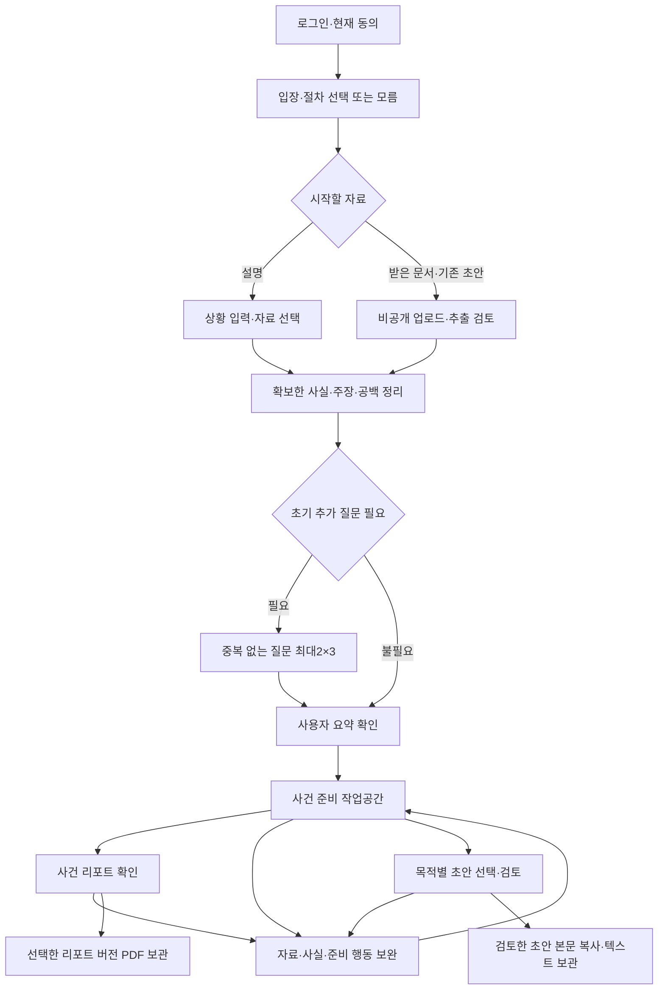

# 민사·형사 준비/대응의 상세 사용자 흐름

- Version: 0.1
- Updated: 2026-11-08
- Status: 사용자 요청에 따른 상세 기획 초안; 구현 승인·제품 변경·법률 인수 아님
- Tracking: [#764](https://github.com/creno-va/baro/issues/764), [문서 PR765](https://github.com/creno-va/baro/pull/765)
- Scope: [기능 범위](./CASE-PREPARATION-SCOPE.md), [ADR-0019](../adr/0019-case-preparation-without-lawyer-platform.md)
- Proposed architecture: [ADR-0020](../adr/0020-procedure-aware-intake-and-working-reports.md)
- Screen structure: [대화·자료·리포트·문서 초안 배치](../design/CASE-WORKSPACE-LAYOUT.md)

## 1. 이번 기획의 기준

사용자는 민사/형사 각각 준비하는 쪽과 대응하는 쪽의 초기 입력·질문·리포트·문서 초안을
구체화하도록 요청했다. 네 경로를 설계 대상으로 삼되 아래 문구·화면 구성·생략 조건·문서군과
갱신 방식은 검토 초안이다. 제품/공통 계약/DB·원격 데이터·정책 버전·배포는 변경하지 않는다.
기존 사건 분야 전체를 네 경로로 강제 변환하거나 기타 분야 데이터를 삭제하지 않는다.

- 계정은 공통 사건 사용자 하나다. 같은 사용자가 사건마다 다른 입장일 수 있다.
- 사건 분야(대여금/임대차/일터 문제 등), 진행 절차, 내 입장, 현재 단계는 별개다.
- 목표는 사실·증거·쟁점과 준비할 일을 이해하고 문서를 보완하는 것이다. 결과/승소·범죄 성립·사실의 진실성을 확정하지 않는다.
- 사건 리포트는 준비 중 수시로 확인한다. 다운로드나 세 액션 선택으로 사건을 종료하지 않는다.
- 리포트의 직접 해결/변호사와 해결/리포트만 저장은 유지한다. 변호사 액션은 기존 결정대로 미지원 모달만 연다.
- 초기 AI 질문은 0~2차례, 차례당 최대3문항을 제안한다. 기존2×3 상한·AI200/일·기술 한도·비용 관측 전용·owner/동의/삭제와 독립 검증을 유지한다.

## 2. 공통 화면과 시작 흐름

사건 상세의 실제 배치/왕복은 [화면 구조 v0.1](../design/CASE-WORKSPACE-LAYOUT.md)에 별도로
정리한다. 대화/리포트/문서 초안을 항상 보이는 세 작업 화면으로, 자료를 어느 화면에서든
여는 보조 패널로 두는 안이다. 화면별 스크롤·입력·자료 선택·초안 편집 보존과 주요 액션,
데스크톱/모바일·직접 URL·W01~W15는 그 문서의 검토 대상이며 현재 구현됐다는 뜻이 아니다.

### 시작 화면

처음부터 법률 용어를 알아야 시작하는 구성을 피한다. 네 경로 카드는 각각 짧은 예시와 함께
보여주고 `어느 쪽인지 모르겠어요`를 보조 진입으로 제공하는 안이다.

| 카드 제안 | 사용자 설명 | 이후 첫 질문/입력 |
| --- | --- | --- |
| 민사 청구 준비 | 돈·보증금·손해배상 등 내 요구를 정리하고 싶어요 | 어떤 해결을 원하나요? |
| 민사 청구 대응 | 돈을 지급하라는 요구나 소장 등을 받았어요 | 받은 문서가 있나요? |
| 형사 고소 준비 | 피해로 겪은 일을 고소장으로 준비하고 싶어요 | 어떤 일이 있었나요? |
| 형사 고소·수사 대응 | 고소됐다는 연락이나 조사 관련 통지를 받았어요 | 어떤 문서나 연락을 받았나요? |

모름을 선택하면 설명/문서에서 절차·입장 후보와 이유를 제안받아 확인한다. 분류만으로
죄명·원고/피고·피의자/피고인 지위를 확정하지 않는다. 분야 선택 자체는 확인된 사실이 아니다.
어떤 경로에서도 문서가 있으면 문서로, 없으면 설명으로 시작할 수 있다.

### 공통 입력과 처리 화면

| 화면 | 제공 기능 | 다음 단계로 넘기는 것 |
| --- | --- | --- |
| 초기 입력 | 자유 설명, 원하는 준비, 알고 있는 현재 단계, 자료 선택/제거 | 원래 입력·선택 경로·모름 구분 |
| 문서 읽기 | 실제 업로드/처리 상태·취소/재시도·쪽/구간 coverage·원본 확인 | 추출 내용과 원문 위치, 판독 실패/누락 |
| 추출 검토 | 문서 종류·발신처·요구/주장·기재 날짜의 교정 | 문서 기재와 사용자 수정 구분 |
| 사실 확인 | 필요한 질문·모름/건너뛰기·저장/재개 | 답변과 미확인 공백 |
| 요약 확인 | 목적/절차/단계·내 설명·상대 주장·핵심 쟁점/모순 | 사용자가 확인한 이해의 기준 |
| 사건 준비 | 대화·자료/사실·타임라인·준비 행동·리포트·초안 왕복 | 새 정보의 영향과 명시적 갱신 |

실명·주소 등 제출 문서에 필요한 식별정보는 사건 이해에 필요한 사실과 구분한다.
처음부터 주민등록번호 등 과도한 식별정보를 요구하지 않는다. 필요한 항목은 문서 작성
단계에서 사용자가 확인하고, 미제공 값은 빈칸/확인 필요로 둔다. 모델 전송 최소화는 유지한다.
문서의 제목/확장자만으로 종류를 확정하지 않으며, 원문·첨부 별지의 누락을 확인할 수 있어야 한다.

## 3. 질문과 요약 확인의 공통 규칙

### 질문은 정보를 채우는 수단이다

초기 질문이 없더라도 추출 검토와 사용자 요약 확인은 유지한다. 반대로 문서를 올렸다는
이유만으로 질문을 무조건 생략하지 않는다. 아래 경로별 질문은 예시 목록이며 전부를
한 번에 질문하라는 뜻이 아니다. 실제 확보한 내용에서 필요한 것만 최대2×3 안에서 고른다.

| 상황 | 제안 동작 |
| --- | --- |
| 원하는 준비·핵심 사건/상대 주장·본인 설명이 충분히 확보됨 | 일반 초기 질문 생략 후 요약 확인 |
| 상대 주장 문서는 있으나 본인 입장이 없음 | 본인 입장과 핵심 공백만 질문 |
| 날짜/금액/당사자/실제 행위가 서로 다름 | 상충하는 원문/진술을 나란히 보여주고 확인 요청 |
| 문서 일부만 판독됨 | 확인 범위를 표시하고 재업로드/설명 보완/현재 범위로 계속 중 선택 |
| 문서 종류/단계를 모르거나 모름·건너뛰기를 선택함 | 추측해 채우지 않고 미확인으로 저장; 사실 리포트로 계속 |
| 두 차례 뒤에도 공백이 남음 | 추가 초기 질문을 반복하지 않고 리포트와 준비 행동에 공백 표시 |

상대 주장별 검토표는 정보 검토 도구다. 모든 행을 답해야만 시작하도록 강제하지 않고
`아직 검토하지 않음`을 허용한다. 표 안에 별도 필수 AI 질문을 숨겨2×3 상한을 우회하지 않는다.
질문 재시도는 같은 작업을 이어가며 이미 제공된 내용을 되묻거나 새 질문 차례를 만들지 않는다.

### 사용자 확인 화면

- `내가 설명한 내용`, `상대방이 주장하는 내용`, `자료에 적힌 내용`, `AI가 정리한 내용`, `아직 확인하지 못한 내용`을 구분한다.
- 경로·목표·절차 단계와 주요 날짜/금액·주장 차이를 검토하고 다른 부분을 설명할 수 있다.
- 계속하기는 BARO의 이해를 확인하는 동작이다. 상대 주장 전체 인정·법적 자백·제출 서명으로 표시하지 않는다.
- 수정 제안의 before/after와 이유를 보고 확인한 뒤 정본에 반영한다. 읽기나 제안 생성으로 기존 정본을 덮어쓰지 않는다.
- 이후 중요한 내용이 바뀌면 관련 부분의 재확인을 제공한다. 새 자료마다 처음부터 질문/사건 생성을 반복하지 않는다.

## 4. 민사 청구 준비

### 초기 입력과 자료

`무엇을 해결받고 싶은지`를 먼저 받고, 상대와의 관계·약정·본인이 한 일·상대가 하지 않았다고
설명하는 일·금액/물건·기존 연락/절차를 정리한다. 계약서·이체/영수 내역·대화·사진·기존
초안은 있으면 추가한다. 법적 청구명·조문·정확한 당사자 주소를 처음부터 알아야 할 필요는 없다.

### 질문 예시와 준비 도구

| 확인할 공백 | 질문 예시 | 연결 기능 |
| --- | --- | --- |
| 원하는 해결 | 돌려받을 돈이나 요구하려는 내용이 무엇인가요? | 요구 항목 목록 |
| 약정/경위 | 상대와 어떤 약속을 했고, 이를 확인할 자료가 있나요? | 약정·사실·자료 연결 |
| 이행/불이행 | 내가 이행한 내용과 상대가 하지 않았다고 보는 부분은 무엇인가요? | 주장별 경위 |
| 금액 구성 | 요구하는 금액의 항목과 이미 받은 금액이 있나요? | 원금/지급/반환/잔액의 근거 구분 |
| 상대 설명 | 상대가 다르게 설명한 부분이나 반대 자료가 있나요? | 상반 내용·약점 검토 |
| 현재 단계 | 이미 보낸 요구나 제출/수령한 문서가 있나요? | 소송 전/진행 중 등 단계 확인 |

금액 표의 산술값과 실제 청구 가능한 금액은 구분한다. 이자·손해액·관할/수수료·기한을
근거 없이 확정하지 않는다. 자료가 없다는 이유로 존재하는 약정이나 행위를 만들어 채우지 않는다.

### 리포트에서 볼 것

1. 원하는 해결과 현재 단계, 청구를 준비하는 이유.
2. 요구 항목 → 관련 사실 → 자료 → 미확인 사항의 연결표.
3. 금액별 사용자 설명/자료 기재/일부 지급·반환 내역과 서로 다른 주장.
4. 상대 설명·불리한 사실·부족한 자료와 먼저 준비할 일.
5. 공식 법 조항·요건별 연결, 판례의 공통점/차이점과 적용 한계.

### 소장 초안

`직접 해결 → 준비 문서 → 소장 초안`으로 진입하는 안이다. 문서 선택은 저장된 초안/준비
조건을 읽고, `초안 만들기`를 명시적으로 누를 때 생성한다. 제목·당사자·청구취지·청구원인·
증거/첨부 목록을 구분하는 구성을 제안한다. 현재 공식 절차/서식과 검증 근거가 확보된 범위만
작성하고 빠진 값은 확인 필요로 남긴다. 사건 진행 중의 추가 서면을 소장으로 잘못 만들지 않는다.

합성 예: 사용자가100만 원을 빌려줬고30만 원을 받았다고 설명하면 두 행위의 날짜·자료와
나머지70만 원이라는 사용자 계산을 연결한다. 이를 법원이 인정한 채무나 자동 이자 청구로 바꾸지 않는다.

## 5. 민사 청구 대응

### 받은 문서를 먼저 구분한다

| 받은 내용 | 처음 보여줄 것 | 우선 문서/도구 |
| --- | --- | --- |
| 소장 | 청구취지·청구원인·상대 자료·문서 기재 날짜 | 주장별 본인 설명, 답변서 검토용 초안 |
| 지급명령/이행권고결정 등 | 실제 문서 종류와 별도 대응 절차 확인 필요 | 기재 내용·송달 관련 사실 검토, 대응 준비 메모; 일반 답변서로 자동 치환하지 않음 |
| 내용증명·이메일·메신저 요구 | 상대 요구·설명·요구 날짜 | 사실/요구 대응 메모; 소송이 제기됐다고 표시하지 않음 |
| 판결문·항소/그 밖의 재판 문서 | 현재 단계를 다시 확인 | 경과/쟁점 정리; 새1심 답변서·항소 초안을 자동 제안하지 않음 |
| 문서 없음/일부만 있음 | 알고 있는 요구와 모르는 범위 | 설명으로 계속, 확보하면 연결; 재시작 불필요 |

문서에 적힌 날짜·사용자가 받은 날짜·법적 송달일·법적 기한은 구분한다. 문서 종류나
확인되지 않은 받은 날짜만으로 자동 기한을 확정하지 않는다. 원문에 명시된 요구 날짜도
상대가 정한 날짜인지 기관 안내인지 출처와 함께 표시한다.

### 본인 입장과 질문

상대 주장을 한 행씩 원문 위치와 함께 보여주고 `내가 기억하는 내용과 같음/일부 다름/다름/
모름/아직 검토 안 함`으로 보완하는 안이다. 사용자가 선택하기 전에는 미검토가 기본이다.
사실에 대한 설명과 상대의 청구 전체를 받아들이는 의사는 다른 항목이다.

질문 예시는 상대가 요구하는 내용, 다르게 기억하는 주요 부분, 이미 지급/이행한 내역,
상대 설명에서 빠진 약속·사정, 이를 확인할 자료, 실제 받은 문서/진행 단계다.
이미 원문과 사용자 검토에 있는 내용을 다시 질문하지 않는다.

### 리포트와 답변 초안

- 리포트의 중심은 `상대 요구/주장 | 내 설명 | 관련 자료 | 다툼/미확인 | 다음 준비` 비교표다.
- 상대 금액과 본인 계산, 인정/다툼의 범위, 일부 자료 누락과 상반 내용을 분리한다.
- 소장 대응으로 확인되면 답변서 초안에 사건/당사자 정보·청구취지에 대한 답변·청구원인에 대한 설명·증거/첨부 목록을 구분한다.
- 사용자 선택 없이 일괄 인정/전면 부인을 넣지 않는다. 모름·미검토 항목을 유리한 주장으로 바꾸지 않는다.
- 문서/절차가 다른 경우 그에 맞는 준비 메모를 제공하고, 근거 없는 공식 서류 명칭을 붙이지 않는다.

합성 예: 상대가100만 원 전액을 요구하고 사용자가30만 원 지급 내역을 보유하면 상대 요구와
본인 지급 설명/자료를 나란히 둔다. 수령 사실을 확인한 것만으로 모든 법적 청구를 인정한 것으로 저장하지 않는다.

## 6. 형사 고소 준비

### 초기 입력과 질문

피해로 설명하는 사건의 경위, 상대가 한 말/행동, 날짜·장소·반복 여부, 직접 경험한 것과
전해 들은 것, 피해와 자료를 정리한다. 진단서·사진·대화·녹음/영상·관련 문서가 있으면
연결한다. 죄명·적용 조문을 사용자가 미리 정하거나 모든 상대 인적사항을 알아야 시작하는 것은 아니다.

질문은 다음 공백 중 필요한 것을 선택한다: 구체적인 행위/말, 발생 시점/장소, 직접 확인한
부분과 추측, 이후 상태·피해, 원본/목격 등 자료의 존재, 이미 신고/고소하거나 다른 설명을 들은 사실.
미상 날짜는 미상으로, 추정은 추정으로 남긴다. 민사 불이행을 입력한 것만으로 범죄 의도·죄명을 생성하지 않는다.

### 리포트와 고소장 초안

| 리포트/작성 도구 | 제공 내용 |
| --- | --- |
| 행위별 사건표 | 누가 언제 어디서 무엇을 했다고 설명하는지, 직접 경험/전언/추정의 구분 |
| 자료 연결 | 행위·피해·대화와 실제 원본 위치/처리 범위, 자동 추출의 한계 |
| 확인할 쟁점 | 검증된 법 조항/요건과 현재 근거, 부족/상반 내용, 죄명·적용 미확인 |
| 준비 행동 | 추가로 확인할 원본·당사자 정보·기억의 공백과 이유 |
| 고소장 초안 | 고소인/피고소인 정보, 고소취지, 사건 사실/고소 이유, 증거/첨부 목록을 구분하는 구성안 |

`직접 해결 → 준비 문서 → 고소장 초안`으로 진입한다. 설명하지 않은 범행 방법/고의·
정확한 인적사항·범죄 성립을 채워 넣지 않는다. 죄명/조문을 확인하지 못한 부분은 미확인으로
남기고 검증되지 않은 법적 주장을 넣지 않는다. 문서 종류의 공식 근거/작성 조건을 확인하지
못하면 명칭과 범위를 사실 정리 메모로 제한한다. 초안은 수사기관의 접수·판단 완료가 아니다.

합성 예: 사용자가 다툼 중 팔을 밀렸고 사진이 있다고 설명하면 사용자 진술과 사진의 촬영/처리
범위를 연결한다. 사진만으로 행위자·발생 시점·진단·죄명을 확정하지 않는다.

## 7. 형사 고소·수사 대응

### 고소장 사본을 필수로 하지 않는다

고소장/발췌본이 있으면 읽고, 없으면 출석요구·기관 통지·메시지 또는 본인이 전달받은
내용으로 시작한다. 고소장 자동 송달/열람·취득을 약속하거나, 내용이 없는데 전체 혐의를
알고 있다고 표시하지 않는다. 상대방의 말과 공식 기관 통지도 출처가 다르다.

| 확보한 내용 | 필요한 확인 | 진행할 기능 |
| --- | --- | --- |
| 고소장/상대 주장 자료 | 문서 범위·상대 주장·추출 오류 | 주장별 본인 설명과 자료 연결 |
| 출석요구/기관 통지 | 발신/문서 종류·기재된 내용/일정·알고 있는 단계 | 확인된 내용과 모르는 범위 정리, 조사 준비 메모 |
| 상대방에게 들은 말 | 누가 무엇을 어떻게 전달했는지 | 전해 들은 주장으로 표시, 공식 통지/단계 미확인 유지 |
| 공소장 등 기소 이후 문서 | 실제 단계·문서 확인 | 공소사실과 본인 설명 정리; 수사 전 단계로 잘못 환원하지 않음 |
| 문서 없음 | 알고 있는 연락·행위·기억 | 설명으로 시작, 추후 자료 연결 |

### 질문·리포트·준비 메모

질문은 전달받은 구체적 주장, 본인이 직접 경험한 경위, 다른 부분/모르는 부분, 관련 원본,
이미 받은 통지/한 설명, 현재 알고 있는 절차 중 필요한 것을 고른다. 모두 부인하거나
상대와 접촉해 설명하도록 유도하지 않는다. 본인이 하지 않은 행동/몰랐던 사정을 만들어내지 않는다.

리포트에는 `확인한 상대 주장/통지 | 내 설명 | 원본 자료 | 상반 내용 | 아직 모르는 범위`와
사용자 경과·준비할 자료·공식 근거가 확인된 절차 안내를 둔다. 일부 주장만 확보했으면
그 범위가 문서 상단부터 드러나야 한다. 고소됐다는 설명만으로 기소·재판·유죄를 표시하지 않는다.

우선 문서는 `사실관계·진술 준비 메모`다. 알려진 주장별 본인 설명, 시간순 경과, 자료 목록,
추가 확인 사항을 담는다. 앱 내 메모를 수사기관이 작성한 진술조서로 부르지 않는다.
의견서 등 공식 명칭의 문서와 재판/불복 서류는 해당 단계·서식 근거가 확보된 별도 검토 범위다.
모든 형사 대응 사용자에게 민사식 답변서를 생성하지 않는다.

합성 예: 기관의 출석 관련 연락만 받은 사용자는 통지 내용과 본인이 기억하는 사실로 시작한다.
고소장 전체를 아는 것처럼 상대 주장 목록을 생성하지 않고, 내용을 확보하면 같은 사건에 추가한다.

## 8. 준비 중 계속 보는 사건 리포트

### 공통 구성과 준비 상태

| 순서 | 내용 | 연결 동작 |
| --- | --- | --- |
| 1 | 지금 내 사건: 절차/입장/단계·원하는 준비·확인 범위 | 다른 부분 설명/요약 재확인 |
| 2 | 지금 준비할 일: 중요 공백·자료·이유·다음 행동 | 관련 자료/사실/준비 행동 열기 |
| 3 | 주장·사실·증거 연결: 경로별 비교/행위/금액 표 | 원문 쪽/시간·자료 검토로 이동 |
| 4 | 핵심 쟁점·약점·상반 내용·미확인 | 근거 확인과 보완 |
| 5 | 관련 법·판례·공식 안내와 적용 한계 | 검증된 원문과 확인 시각 |
| 6 | 자료 목록·실제 처리 범위·작성 기준 | 현재 사건과 저장본 차이 확인 |

요약 확인 뒤 첫 사건 리포트는 확보한 사실과 공백을 확인하는 용도로 열 수 있게 제안한다.
법률 분석 미완료 때문에 사실까지 숨기지 않는다. 근거 확인 중·일부 확인·관련 결과 없음·
조회 실패는 각각 표시하고, 빈 법률 설명을 완성된 분석으로 표현하지 않는다.
첫 문서 준비가 안 된 경우에도 사용자는 리포트/자료/대화를 계속 이용할 수 있다.

### 변경과 갱신

| 변경/상태 | 사용자 표시 제안 | 동작 |
| --- | --- | --- |
| 새 자료 추가/교정 | 이 자료가 아직 반영되지 않았어요 | 영향 확인→필요한 사실/요약 재확인→명시적 반영 |
| 입장·목표·단계/핵심 사실 변경 | 작성 기준이 현재 사건과 달라졌어요 | 이전 리포트/초안 보존→새 기준 검토 |
| 공식 원문 확인 기간 경과 | 사건 내용은 보존됐어요. 법률 근거의 현재성 확인이 필요해요 | 사실 수정과 구분해 갱신 필요 안내, 검증 우회 없음 |
| 본문 직접 수정 | 사용자가 수정한 내용이에요 | 저장/검토와 법률 근거 검증 상태 구분 |
| 분석 실패/진행 중 | 현재 가능한 범위와 아직 확인하지 못한 부분 | 이전 저장본 보기·필요할 때 명시 재시도 |

리포트 읽기/패널 열기/탭 이동/다운로드는 새 AI나 법률 API를 시작하지 않는다. 갱신을
요청할 때 대상 범위·실제 진행 상태를 보여주고, 작업 중 새 편집이 생기면 결과를 자동 덮어쓰지 않는다.
현재 사건 보기와 특정 저장 버전 보기를 구분한다. 작업 실패는 원래 입력/자료의 소실을 뜻하지 않는다.

### 기존 세 액션

- `직접 해결`: 현재 단계의 준비 문서·저장한 초안·부족한 항목을 확인한다. 생성은 별도 명시 실행이다.
- `변호사와 해결`: 기존 결정의 미지원 모달만 표시한다. 실제 연결/선택 저장/외부 이동/공유·AI 실행은 하지 않는다.
- `리포트만 저장`: 선택 버전의 검토/가림/사진·PDF 보관으로 이어진다. 저장 후에도 사건 준비를 계속한다.

## 9. 문서 초안의 공통 기능과 제공 조건

| 단계 | 제공 기능 | 완료/제한 기준 |
| --- | --- | --- |
| 종류 선택 | 절차/입장/단계에 맞는 우선 문서와 범위 안내 | 미확인 절차에 공식 문서 종류를 자동 확정하지 않음 |
| 작성 기준 검토 | 사용할 요약·사실/자료·분석·현재성 확인 | 실제 확보된 근거만 사용; 부족 항목 표시 |
| 명시 생성 | 기존 bounded gateway·공식 출처·독립 audit/claim 검증 | 생성 실패/부분 미완료를 성공으로 표시하지 않음 |
| 초안 검토 | 본문·문장/주장의 근거·빠진 필드·불리한 내용 | 사용자 주장과 확인 근거 구분, 허구 값 채우기 금지 |
| 작성 중 보관 | 입력 복구·중단/재접속·소유자 변경 처리 | 임시 보관과 검토 완료를 분리; 정확한 저장 계약은 제안 ADR에서 정함 |
| 저장/내보내기 | 사용자 편집·검토 확인, 선택 버전·자료/식별정보·사진 범위 확인 | 검토 표시가 제출 적합성/법률 승인/실제 제출을 뜻하지 않음 |
| 새 정보 반영 | 바뀐 부분 비교·새 후보 생성·선택 적용 | 이전 편집본/저장본/PDF 보존, 자동 통째 덮어쓰기 없음 |

필요한 사실이 부족하면 빈칸과 확인 필요가 있는 초안을 검토할 수 있다. 공식 문서 종류의
근거/단계가 확인되지 않거나 법적 설명을 검증하지 못하면 지원되는 사실 정리 문서로 범위를
제한한다. 편집한 법적 주장에 이전 검증 표시를 그대로 붙이지 않는다.
`작업 중`, `사용자 검토`, `근거 확인`, `현재 사건 반영`, `저장 버전`은 서로 다른 상태다.
원문 자료는 PDF의 식별정보 가림으로 변경되지 않는다. 제출·송달·연락·접수 확인은 자동 수행하지 않는다.

내보내기는 리포트의 기존 PDF와 초안의 검토용 본문 복사/텍스트 보관을 우선한다. 현재
초안 다운로드는 검토용TXT이며, 이 기획으로 초안 PDF/DOCX 조판까지 이미 제공한다고
표시하지 않는다. 공식 제출 형식에 맞춘 별도 문서 조판은 후속 검토 항목이다.

우선 상세 설계 문서군은 소장·소장 대응 답변서·고소장·형사 사실/진술 준비 메모다.
지급명령 등은 잘못된 서류를 생성하지 않도록 식별/안내부터 설계하고, 이의/불복·가압류·
고발/탄원 등 추가 공식 문서의 생성은 별도 상세 기획 후 검토한다. 기존 저장 초안의 읽기/
다운로드·설치 client 호환을 이번 제안으로 제거하지 않는다.

## 10. 예외와 기획 인수 시나리오

| ID | 시나리오 | 확인할 결과 |
| --- | --- | --- |
| J01 | 문서 없는 민사/형사 준비 | 설명→필요 질문→요약→리포트→경로별 초안의 흐름 설명 가능 |
| J02 | 충분한 문서와 본인 설명 | 중복 질문0회, 추출/요약 확인은 유지 |
| J03 | 문서는 있으나 본인 입장 없음 | 상대 주장을 사실로 승격하지 않고 필요한 질문만 수행 |
| J04 | 지급명령/판결문을 소장으로 잘못 분류 | 사용자가 교정하고 잘못된 답변서/항소 생성 방지 |
| J05 | 형사 통지만 있고 고소장 없음 | 문서 요구로 막지 않고 알려진 범위/미확인 표시 |
| J06 | OCR/음성·영상 일부 처리 실패·별지 누락 | coverage 확인·교정/재시도/현재 범위로 진행, 원본 보존 |
| J07 | 최대 질문 뒤 모름/공백 존재 | 질문 루프 없이 공백을 리포트/준비 행동에 유지 |
| J08 | 상대 주장 여러 행과 일부 미검토 | 전체 행 답변 강제 없음, 초기 질문 한도 우회 없음 |
| J09 | 같은 사실관계의 민사/형사 병행·맞대응 | 절차/입장별 문서와 근거 분리, 한 결과로 다른 절차 완료 주장 없음 |
| J10 | 자료/요약 변경 중 초안 생성·동시 편집 | 이전 편집 보존, 변경 표시·재확인·명시 적용, 늦은 덮어쓰기 없음 |
| J11 | 출처 만료·조회 실패·판례 없음 | 사용자 사실 변경과 구분, 사실 리포트 유지, 새 법률 설명을 임의 생성하지 않음 |
| J12 | 임시 보관 후 재접속·다른 계정 전환 | 본인 초안 복구, 타인/이전 사용자 내용 비노출, 검토 완료 위장 없음 |
| J13 | PDF 저장 뒤 자료를 더 추가 | 기존 bytes/작성 기준 보존, 새 준비/갱신 계속, 사건 자동 종료 없음 |
| J14 | 변호사와 해결 클릭 | 미지원 모달만 표시, 선택/편집/다른 두 액션 유지, 네트워크 mutation0 |
| J15 | 필수 동의 변경·삭제/owner 변경·quota/기술 오류 | 기존 보안/삭제/실제 기술 한도 유지, 비용 관측 실패로 기능 차단 없음 |

이 표는 후속 구현의 목표 시나리오다. 현재는 문서 검토만 했으며 실제 실행/인수 성공을 주장하지 않는다.

## 11. 조사 근거와 아직 정할 것

2026-11-08 다음 공식 안내를 기획 참고로 읽었다. 이 링크는 BARO의 runtime 검증 citation/
원문 snapshot이나 개별 사건의 제출 가능성 검증이 아니다. 문서 구성은 제품 제안이며 현행
양식의 전 항목/필수성·관할·기한/예외를 인수한 것으로 표시하지 않는다.

| 출처 | 반영 범위 | 한계 |
| --- | --- | --- |
| [법제처 금전거래 민사소송](https://www.easylaw.go.kr/CSP/CnpClsMainBtr.laf?ccfNo=4&cciNo=6&cnpClsNo=1&csmSeq=272) | 소장에 청구 내용/이유·당사자 등을 구분한다는 흐름 | 금전거래 예시의 이율/관할·절차 설명을 다른 사건에 일반화하지 않음 |
| [법제처 나홀로 민사소송](https://m.easylaw.go.kr/MOB/CsmInfoRetrieve.laf?ccfNo=1&cciNo=1&cnpClsNo=2&csmSeq=568) | 민사 문서·절차별 확인 | 기존 범위 조사에서 본문 확인. 개별 송달/기산점 검증은 별도 |
| [법제처 지급명령](https://www.easylaw.go.kr/CSP/CnpClsMainBtr.laf?ccfNo=3&cciNo=3&cnpClsNo=2&csmSeq=568&menuType=cnpcls&popMenu=ov) | 일반 소장 대응과 구분할 필요 | 이번 검색 수집 본문 확인; 상세 이의서 생성/기한 계산은 미인수 |
| [광주경찰청 고소/고발 안내](https://www.gjpolice.go.kr/sub.do?mid=7020387&r=gjpolice) | 고소/고발 구분과 공식 서식 경로 존재 | 본문 확인. 오래된 절차/권한·기간 문구는 현행 검증 없이 복사하지 않음. 연결된 양식 원본 전항목 미검증 |
| [경찰민원24](https://minwon24.police.go.kr/main.do) | 공식 민원/서식 경로 참고 | 검색 수집 본문 확인. BARO가 제출/접수·사건 자동 조회를 지원한다는 의미 아님 |

후속 검토 항목은 첫 문서군/세부 사건 유형의 검증 범위, 질문0회 판단의 필수 정보,
복합 절차를 한 사건 내 보기로 둘지 별도 사건 연결로 둘지, 작업 중 초안 보관 계약,
명시적 갱신과 기존 자동 분석의 관계다. 네 흐름을 설명하는 데 필요하지 않은 새 공급자/
조직/외부 연결 구조를 먼저 만들지 않는다. 상세 설계를 구현으로 옮기기 전 사용자 검토와
공통 계약·회귀 fixture 계획을 별도로 확정한다.
