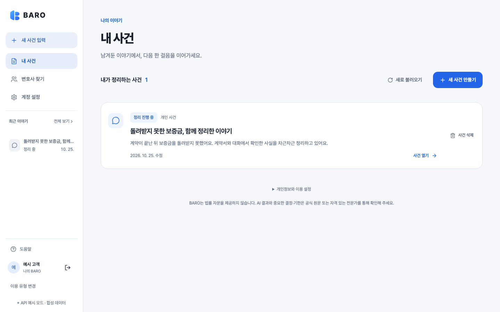
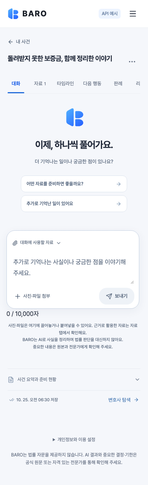
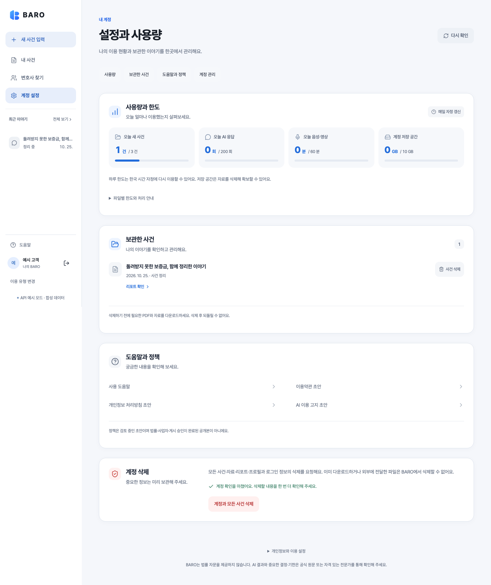
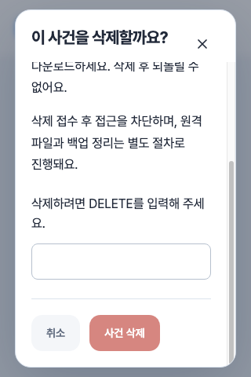
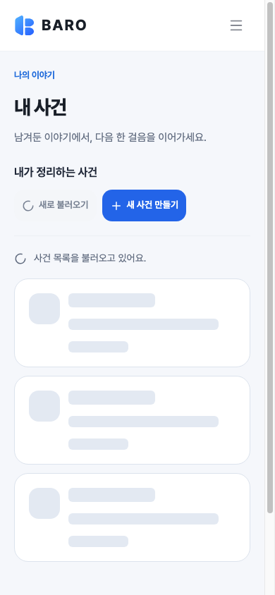

# 앱 내부 경험 정비 — 2026-10-25

- 추적: [#522](https://github.com/creno-va/baro/issues/522), `codex/522-app-experience`
- 출발점: main `999b127167283d9d5b4268360ceb582a02a7661c`, 해당 main CI SUCCESS
- 범위: 웹 앱 표현·상태·레이아웃. 랜딩, RN, 서버, API/계약, DB는 변경하지 않는다.
- AI #458/#506 담당과 직접 조율: `Workspace.tsx`, `PrecedentResearch.tsx`, `CaseNavigation.tsx`의 기능 소유권은 AI 담당에게 유지한다. 공통 UI와 앱 전용 CSS를 여기서 소유한다.

## 조사와 설계 판단

토스의 화면을 복제하지 않고, 기존 랜딩의 파랑·Pretendard·충분한 여백·둥근 모서리를 앱의 읽기와 작업에 맞게 적용한다.

| 근거 | 적용한 판단 |
| --- | --- |
| [토스의 8가지 라이팅 원칙](https://toss.tech/article/8-writing-principles-of-toss) | 현재 수행하는 작업과 다음 행동을 알 수 있게 안내한다. 로딩·빈 목록·연결 오류를 서로 구분하고, 기술 구현 문구를 새로 노출하지 않는다. |
| [인터랙션, 꼭 넣어야 해요?](https://toss.tech/article/interaction) | 모션을 누름·상태 변화·화면 열림의 피드백으로 사용한다. 공통 easing과 160/240ms 전환을 사용하며 대화/요청에 인위적인 지연을 추가하지 않는다. |
| [첫 인터랙션 디자이너가 문제를 해결하는 법](https://toss.tech/article/1st_interaction_designer) | 기다릴 때 실제 단계와 저장된 내용을 존중한다. 확인하지 않은 진척률·완료 시간·성공 상태를 만들어 표시하지 않는다. |
| [W3C 상태 메시지](https://www.w3.org/WAI/WCAG22/Understanding/status-messages.html) | 상태 문구와 장식용 spinner/skeleton을 분리한다. 오류 안내·기존 live region·권한 철회 동작을 보존한다. |
| [W3C 텍스트 대비](https://www.w3.org/WAI/WCAG22/Understanding/contrast-minimum.html) | 카드와 캔버스는 면·테두리로 나누고 본문/보조 문구의 대비를 axe 및 실제 PNG로 검사한다. 일반 글자 4.5:1, 큰 글자 3:1을 기준으로 한다. |
| [W3C 인터랙션 모션](https://www.w3.org/WAI/WCAG22/Understanding/animation-from-interactions.html) | `prefers-reduced-motion`에서 회전·펄스·모달 진입·누름·페이지 전환 효과를 중지하고 문구로 상태를 유지한다. |

## 발견한 문제와 구현

- 기존 `.sidebar-desktop` 전체가 `overflow-y:auto`여서 최근 목록이 계정 영역을 밀었다. 상단 메뉴와 하단 계정은 고정하고 가운데 `.sidebar-recent__list`만 스크롤한다. 목록은 키보드로도 스크롤할 수 있고, 읽기 실패를 빈 목록으로 표현하지 않는다.
- 공통 native Dialog는 Escape의 기본 닫기를 차단하고 소유 컴포넌트에 닫기를 요청한다. 처리 중 소유자가 닫기를 거절해도 모달이 먼저 사라지지 않으며, 중첩 모달의 Escape가 부모까지 전파되지 않는다.
- 데스크톱의 일반 dialog는 viewport 중앙에 두고, 긴 내용은 dialog 안에서 스크롤한다. 공통 dialog의 제목·닫기는 스크롤 밖에 유지한다. 작은 화면과 모달 내부 가로 overflow, Escape·focus 복귀·중첩 모달은 별도로 확인한다.
- 높이 560px 이하의 데스크톱 창은 상단 메뉴 버튼을 사용한다. 가로 모바일 메뉴도 헤더를 유지하며 계정까지 접근할 수 있다.
- 캔버스 `#f5f7fb`, 흰 카드, 명확한 테두리와 안쪽 여백을 사용한다. 사건 목록의 읽기 영역과 삭제 액션을 분리하고, 설정·검색 카드와 채팅 입력 면·내 메시지·추천 질문의 식별성을 보강한다.
- `LoadingContent`는 목록·디렉터리·상세·사용량의 구조를 예약한다. 사건 목록, 질문, 요약, 공개 프로필, 계정 사용량, 리포트에 연결한다. 재조회 시 기존 내용은 해당 화면의 기존 권한/복구 규칙을 따른다.
- 공통 Button의 명시적 `loading`은 spinner와 중복 제출 방지를 제공한다. 검색은 진행 중에도 다른 조건으로 다시 검색할 수 있는 기존 취소 동작을 유지한다. 초기 상태·로그아웃·기존 StatePanel·설정/리포트 작업에도 회전 피드백을 연결한다.
- `app-experience.css`는 AppLayout에서만 읽는다. `global.css`, `shell.css`, `product.css`, BaseLayout, index 및 랜딩 코드·자산·스타일은 그대로 보존한다. 공통 spinner의 작은 CSS는 해당 컴포넌트를 사용하는 인증 화면에도 적용한다.

## 검증과 증거

서로 다른 브라우저 시나리오 134개와 production CSP 검사 7개가 성공했다. 모든 입력과 계정은 합성이며 유료 모델 호출을 하지 않는다. 아래 결과는 실제 OAuth/공급자/production 인수를 대신하지 않는다.

- `bun ci`: frozen 설치 성공.
- `bun run validate:quick`: lint·타입·경계·문서/작업 그래프 및 선택 계약 검사 성공(457 tests).
- `bun run validate:build`: production build, bundle, Worker dry-run 및 local workerd의 익명 로그인 응답 성공.
- 기존 product UI 12개: 주요 화면 320/390/768/900/901/1024/1440px, 입력창 위치, 자료·타임라인 dialog, 읽기/편집, 200% 글자 확대와 axe 검사.
- AI PR521/main2803b4f 통합 후 `validate:quick` 549개와 build/local workerd도 성공했다.
- 신규 app-experience 7개: 합성 사건 30개, 1440px 폭·600/720/900px 높이의 독립 사이드바 스크롤; 320/390/768/1024/1440/1920px 모달; 지연/실패 spinner·skeleton; reduced motion; 모바일/가로 메뉴·classic scrollbar·200% 확대·axe; 검색·프로필 대기/오류; 처리 중 삭제의 Escape/닫기 거절과 중첩 모달 Escape·focus 복귀.
- 로그인·동의·랜딩·리포트 기존 회귀 66개 성공. 랜딩의 영상/스크롤/접근성·모바일 상호작용도 유지됨을 확인했다.
- production CSP 7개 성공. 정상 배포에 합성 UI fixture가 없는 것을 검사했으며, 명시적 fixture build 전용 1개는 정상 배포 검사에서 제외했다.
- AI PR525를 합친 추가 채팅 검사는 처음 10 성공/1 실패였다. 이전 내용을 읽기 위해 위로 이동해도 진행 중인 native smooth 자동 스크롤이 2/9px 잔여 이동을 일으켰다. 임시 계측으로 이를 관측했고, CSS anchor/진입모션 시도는 반복 검증에서 해결되지 않아 제거했다. 담당의 PR527(main `112719aff3e480e843c4048a4a615019dc23b655`)이 자동 follow를 instant로 통일했다. UI와 PR527의 일시 통합에서 원본 위치 유지 검사 3회 및 채팅 11개 전체가 성공했다. 원본 검사를 완화하거나 기능 소유권을 넘겨받지 않았다.
- 계정/세션 복구 회귀 15개 성공. 처음에는 보조 사이드바 오류와 본문 상태를 동시에 선택해 13 성공/2 실패였으며, 본문 상태로 locator를 한정한 뒤 15개 전체가 성공했다.
- 앞선 6개 파일 회귀는 39 성공/1 실패였다. 인증 테스트가 새 사이드바 상태와 본문 상태를 동시에 선택하던 strict locator 문제였고, 검사 대상을 main으로 좁혔다. 이후 인증 전체가 포함된 위 66개가 성공했다. 제품 인증 guard는 변경하지 않았다.
- 신규 프로필 지연 fixture의 첫 실행은 self-service 선행 endpoint를 가로채지 못해 4 성공/1 실패했다. 두 조회 경로를 함께 가로채도록 fixture를 고쳐 5개가 성공했다. 실제 공급자 오류로 해석하지 않는다.

최종 PR head와 CI 결과는 #522와 PR에 기록한다. 전체 `validate:full`·동일 SHA preview/production 배포는 운영 문서의 수동 절차와 별도 승인/검증 범위를 따른다.

## 배포 전 확장 검사 보강

PR526/main `1bca69473da2182a781655b671e09b764fb6cfe0`의 필수 CI와 PDF/Linux 검사가 성공한 뒤, 도움말·정책·변호사 및 긴 통합 흐름을 더 검사했다. shell 검사에서 2개, 정책 검사에서 1개가 실패해 #522를 다시 열었다. 해당 SHA의 수동 full40136789449는 알려진 결함을 수정한 후보로 대체하기 위해 취소했으며, 성공한 full로 기록하지 않는다.

- main 전체 진입 fade 중 정책의 작은 글자가 배경과 합성되어 대비 4.33:1로 관측됐다. 정적 색상 토큰과 정책 내용은 유지하고 전체 main fade를 제거해 읽기 콘텐츠가 처음부터 충분한 대비로 표시되도록 했다. 모션은 누름·상태·모달 피드백에 유지한다.
- 모달 진입의 translateY가 짧은 순간 중앙점을 5.75px 옮겼다. opacity/scale은 유지하고 수직 이동을 제거해 진입 중에도 중심이 유지되도록 했다.
- landscape 메뉴의 기존 검사는 dialog 전체가 스크롤되는 구조를 기대했다. 내부 content가 스크롤되고 외부 dialog/header는 고정되는 새 계약을 검증하도록 조정했다. 닫기·focus 복귀 검사는 유지했다.

수정 후 shell 통합9개(기존 제외2개), 변호사8개와 도움말/정책1개가 성공했다. 새 최종 head의 quick/build 및 나머지 영향 검사, 정상 PR/CI·main과 수동 full 결과는 #522에 이어 기록한다. 랜딩과 실제 사용자 입력 중인 preview는 변경하지 않는다.

추가 계정 상태 검사에서는 `needsConsent=true`인 공개 페이지에서 실제 최근 사건 조회를 하지 않으면서 loading skeleton이 계속 보이는 것을 재현했다. 기존 조회·권한 규칙은 유지하고 이 상태의 최근 목록 영역만 숨겨, 이미 제공되는 `/consent` 계정 액션으로 필수 확인을 이어가도록 했다. 원본 red와 수정 후 집중8개 검사를 보존하며, 동의 완료 계정의 목록·spinner·오류·스크롤 동작도 함께 검증한다. AI 담당의 PR529/main e02b3f8까지 통합해 공통 UI와 새 전용 패널의 파일 소유권을 유지한다.

## 전체 검증에서 발견한 클릭 영역 변화

수동 full40137653231/main `a5525c2281e593591290957a2141b81f2a6a6190`는 Workspace 79개 중 69개 성공/10개 실패로 종료됐다. 실패는 focus·권한 재확인·중복 클릭·드래그·pointercancel의 기존 exact-pointer-geometry 단언이었다. 공통 `:active`의 `scale(0.98)` 때문에 누르고 있는 버튼이 112×44px에서 약111.07×43.64px로 줄었다. 보안/선택 대상/포인터 검사를 완화하지 않고 버튼 scale과 transform transition을 제거했다. 색상·테두리·그림자 전환과 spinner·모달 모션은 유지한다.

macOS에서 수정 전 기존 집중11개는 성공했으므로 이를 red 재현으로 표현하지 않는다. 모션을 명시적으로 활성화하고 포인터를 누른 채 버튼의 transform·정확한 사각형·실제 dialog 열림을 검사하는 독립 회귀를 추가했다. 기존 full 실패와 후속 검증을 별도로 보존한다. 이미 알려진 결함을 포함한 full40139782041/main1771은 수정된 후보로 대체하기 위해 취소했으며, 성공한 full로 기록하지 않는다.

수정 후 집중9개와 quick/build/local workerd가 성공했다. 추가 Workspace 전체 검사는 처음78개 성공/1개 실패였으며, AI 변경으로 메뉴의 실제 접근성 이름이 `판례`에서 `유사 판례`로 바뀌었는데 검사만 이전 이름을 요구하던 문제였다. href·메뉴 개수·나머지 흐름은 유지하고 해당 locator를 현재 label로 갱신했다. 후속 전체79개 결과와 최종 main SHA 수동 full은 #522에 기록한다.

최종 UI 후보 main `b6bbdffaf3395704b035163a81dddfabe12b848f`의 full40141383527에서는 Linux에서도 Workspace79개가 모두 통과했다. 이어지는 reports-integrated 첫 시나리오는 두 번의 intake, PDF/ZIP, 여러 reload와 사건/계정 삭제를 하나의 기본30초 제한 안에 수행하다 마지막 설정 화면에서 deadline을 소진했다(3개 중2개 성공). 동일 소스의 로컬 검사는3개 성공, 긴 첫 흐름은20.4초였다. mock의 `canDelete` 계산과 실제 재인증 guard를 확인했으며 제품 삭제 조건은 변경하지 않는다. 긴 시나리오의 전체 예산만60초로 정하고 삭제 준비는 명시적5초 단언으로 확인해, 실제 준비 실패를 긴 전체 제한과 구분한다. 삭제·원본 제거·peer 비공개 내용 철회 단언도 유지한다. 이 full에서 후속 CSP/audit/native는 실행되지 않았으므로 성공으로 기록하지 않는다.

## 최종 합성 화면

