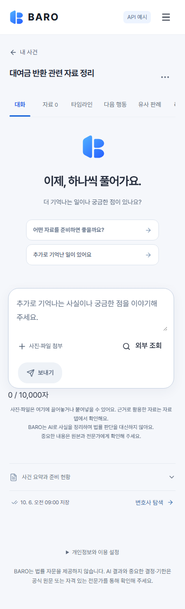
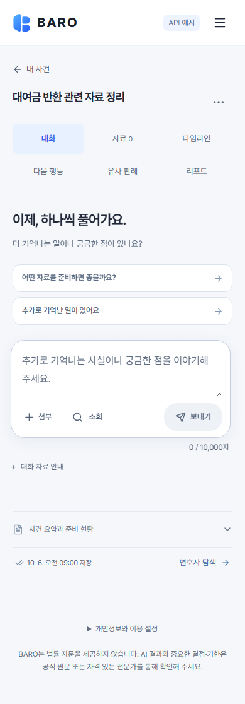
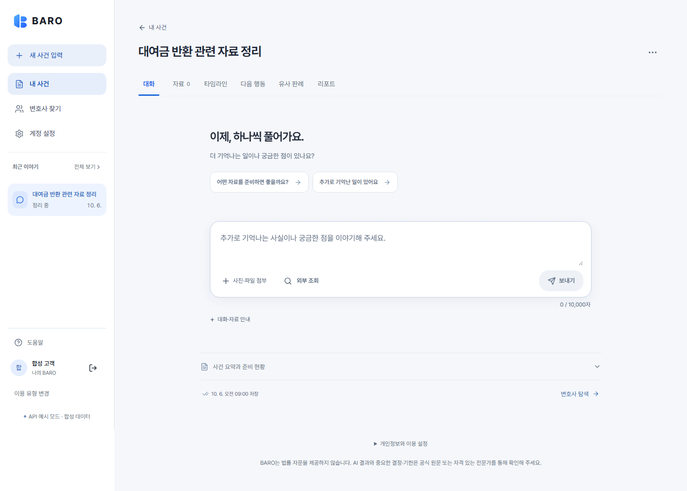

# 작업공간 정보 위계와 모바일 입력 정비

추적은 [#549](https://github.com/creno-va/baro/issues/549), 브랜치는
`codex/549-app-hierarchy`, 출발점은 CI가 성공한 main
`483b45ff9a6ef0568114073aed8cf4664b6c1691`이다. #522의 앱 공통 정비를 이어서
실제 사건 화면의 가려진 메뉴와 입력 동선을 정리한다. 랜딩·네이티브 앱·서버·계약·DB·
모델·외부 API 설정은 변경하지 않는다.

## 설계와 변경

[토스의 라이팅 원칙](https://toss.tech/article/8-writing-principles-of-toss)의 짧고 명확한
안내, [가치와 수고의 순서](https://toss.tech/article/value-first-cost-later),
[디자인 시스템](https://toss.tech/article/toss-design-system)의 일관성과 가변 폭 대응을
참고했다. 현재 사건, 선택한 메뉴, 입력할 내용, 주된 행동 순서로 읽히도록 했다.

- 모바일에서 사건 메뉴 6개를 3열×2행으로 표시한다. 기존 높은 specificity의 가로 스크롤
  규칙이 가리던 리포트도 바로 보이며, 현재 메뉴는 배경과 글자 굵기로 구분한다.
- 빈 대화의 반복 로고와 과한 진입 여백을 줄이고, 짧은 안내·추천 질문·입력 영역을 정렬한다.
  추천 질문은 기존처럼 초안만 채우며, 자동으로 메시지를 보내지 않는다.
- 모바일 첨부·조회는 짧은 표시와 기존 전체 접근성 이름을 사용하고, 보내기는 오른쪽에
  유지한다. 조회는 기존 설정 조건을 그대로 따르며 키가 없는 실제 서비스에서는 나타나지
  않는다. 캡처는 조회가 있는 최악 폭을 검사하는 명시적 mock 모드다.
- 글자 수를 작은 보조 정보로 구분하고, 초과하면 기존 alert와 전송 차단을 유지한다.
  반복되는 대화·자료 안내는 키보드로 여는 details로 이동했다. 사건 하단의 법률 안내와
  실제 첨부 처리/외부 전송 동의는 계속 표시한다.
- 사건 본문 전체의 opacity/위치 진입 효과를 제거했다. 처음 표시되는 내용과 클릭 위치가
  움직이지 않으며 실제 대기·실패·저장 상태와 기존 spinner는 유지한다.

## 실제 로컬 검증

명시적 합성 입력과 Chromium을 사용했다. 실제 사용자·API 키·모델 호출은 없다.

- 작업공간 전체 브라우저 86개가 성공했다. 기존 첨부·업로드/응답 재시도·lost ACK·권한/
  동의 철회·포커스·pointer·자료/타임라인/행동·axe 검사를 유지한다.
- 새 5개는 320·390·768·1440px의 메뉴 6개 가시성, 가로 넘침 없음, 44px 제어와 16px 이상
  입력, 같은 줄의 첨부/조회/보내기, 첫 화면 안 보내기, 전체 본문의 불투명·고정 위치,
  추천 질문의 초안/포커스, details 키보드 토글을 검사한다. 320×568px·root 200% 글씨·
  reduced motion에서도 입력 보존과 입력/보내기 스크롤 접근을 검사했다. 이는 모든 OS의
  시스템 글꼴 크기나 실제 소프트 키보드 인수를 대신하지 않는다.
- 공식 mock 통합 설정의 추가 3개가 성공했다. 긴 사건과 리포트/메뉴, 자료→원본→PDF→
  리포트→사건/계정 삭제, 320·390·900·1440px 서비스 화면 재배치를 포함한다.
  처음 기본 config로 시작한 별도 시도는 합성 API 설정이 없어 로그인 필요 화면에서
  실패했고, 이 작업 소유 프로세스를 중지한 뒤 공식 설정으로 실행했다. 성공으로 세지 않는다.
- 제품 UI 전체 12개도 성공했다. 7개 폭의 목록·검색·설정·사건/자료/타임라인/리포트,
  초기 요약 수정, 리포트 읽기/편집, 키보드/확대 글자와 axe를 포함한다.
- 최종 캡처를 직접 확인했다. 390px에서 보내기 상단은 약761px→639px, 1440px에서는
  약704px→567px로 이동했다. 모든 폭의 문서 너비가 viewport를 넘지 않는다.

frozen 설치와 quick이 성공했다. 보안 패치9·공통/mobile525·RN108·마지막603성공/
기존 host전용2제외다. production build/bundle·dry-run·실제 로컬 workerd의 익명 HTML도
통과했다. 정확 PR/CI/main 결과는 이슈에 기록한다. 소스와 PNG의 유한 SHA-256은
[측정 receipt](./app-hierarchy-2026-10-27/layout-receipt.json)에 보존한다.
이는 출발 main 위의 로컬 UI 후보 파일 검사이며, 실제 배포나 native binary 증거가 아니다.

## 정확한 main 전체 검사에서 확인한 문제

수동 [full40386960386](https://github.com/creno-va/baro/actions/runs/40386960386)의 정확
main483b45f는 quick·전체 Bun4381/기존host2제외·DB·offline eval·build를 통과한 뒤
제품 UI의 모바일 보내기 아래가856.234375px로844px를 넘어서 실패했다. 이 단계의
11성공/1실패를 전체 성공으로 기록하지 않는다. 나머지 브라우저·CSP·raw audit·실제
Gitleaks·native Docker와 성공 release receipt는 실행되지 않았다.

새 UI 후보의 원래 제품 UI 검사에서는 이 보내기 단언을 변경하지 않고 통과했다.
처음12개 중10성공/2실패는 320·390px 메뉴가 모두 같은 줄이어야 한다는 이전 기대값이었다.
새 모바일 2행/데스크톱 1행과 6개 링크 모두 viewport 안에 있다는 더 구체적인 계약으로
교체했고, 최종12개 전체가 성공했다. 최종 main의 후속 수동 full은 이 실패와 구분한다.

## 랜딩 보존

랜딩 코드·자산·전역 shell/BaseLayout을 수정하지 않는다. `product.css`는 AppLayout에서만
가져오며 변경한 규칙도 `.app-frame.app-frame--product` 범위다. Workspace CSS/컴포넌트는
사건 화면 전용이다. 같은 합성 계정·폰트 대기·reduced motion 조건으로 320·390·1440px의
랜딩 body/main/h1/header/주요 링크 배치와 computed style을 비교했다. 모두 정확히 같고,
각 폭의 전후 PNG 전체 SHA-256도 같다. 랜딩의 `.app-frame`은 모두 0개다.

## 합성 화면

수정 전 모바일:

수정 후 모바일:

수정 후 데스크톱:

원래 #339의 raw 보안 결과, #506의 실제 미확정 transport와 #71의 최종 릴리스 조건은
각각 유지한다. UI 검증을 실제 공급자 종료나 전체 출시 승인으로 확대하지 않는다.
