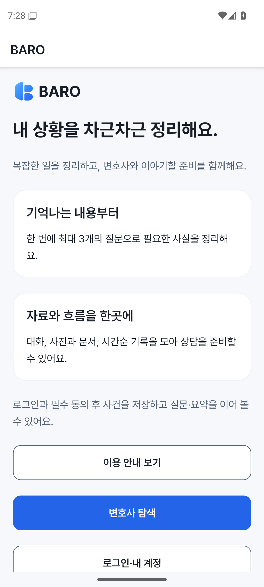

# 모바일 실제 실행·내부 개발 앱 증거

관측 대상 source는 `c2fa3f23394a349bf7cf7d33dee64a433d29e634`다. PR389의
Quality gate39915601296/SDK host39915601362와 main CI39915841507이 성공했다.
[이슈385](https://github.com/creno-va/baro/issues/385)에서 이전 실패와 현재 범위를 보존한다.
웹 소유 경로·제품 router·server/schema를 변경하지 않은 검증이다.

## 실제 Android 로컬 실행

[수동 runtime39916204937](https://github.com/creno-va/baro/actions/runs/39916204937)의
Android job120290228109가 성공했다. Android15/x86_64 Emulator의 계측 Home layout과
실제 RN→native module→Expo SDK 경로를 실행했다. 별도 임시 worktree·새 소유 AVD와
loopback 합성 fixture만 사용했으며 실제 사건/계정·제공자·유료 호출은 사용하지 않았다.

[receipt](./mobile-runtime-2026-10-23/receipt-android.json)를 다운로드해 strict schema·source/
platform·원본 Home/overlay/probe source hash와 합성 전체 byte/hash를 독립 대조했다.
100,000,000bytes PUT의 SHA256은 `83d30385a4a11980275dc23de3fb49ff37b906cc841efa048a96c62d90ff3b5f`,
1,000,000,000bytes download는 `c81ea537d85888c161118b7ac8dc75be6cdeaf291790cb36ab34f3c7833e9abc`다.
SDK snapshot/readback·SecureStore readback·미확정 key 보존,401/Origin·owner fencing,
전송 중 source clear/취소와 owned file cleanup을 실제 실행했다. 요청5회·header 거절0회,
취소 upload24,576bytes와 remaining source/download/native file0개를 확인했다.

Home layout은411.43×809.52이고, process RSS 표본440개 중 최대 관측381,427,712bytes다.
전체 실행 peak나 JS heap 상한을 증명하지 않는다. 계측 Home mount는 전체 제품 여정/
DocumentPicker·공유 UI·접근성·원격 API/OAuth·물리 기기 인수가 아니다.

## preview 개발 앱 전달물

[수동 build39916208240](https://github.com/creno-va/baro/actions/runs/39916208240)의
두 OS job과 workflow가 성공했다. 두 파일을 실제 다운로드해 전체 byte/hash·포함 TTF를
대조했다. Android ZIP의 native ABI와 iOS Info.plist/Mach-O ABI·binary ad-hoc signature도
독립 확인했다. Android 실제 SDK apksig certificate 검증은 CI에서 수행했으며 로컬에
SDK/JDK가 없어 로컬 cryptographic APK 검증을 다시 했다고 표현하지 않는다.

| 전달물 | 실제 파일·지원 대상 | 확인한 전체 파일 SHA256 |
| --- | --- | --- |
| [Android APK](https://github.com/creno-va/baro/actions/runs/39916208240/artifacts/12485482082) | 162,497,066bytes/API24+/arm64-v8a·x86_64/debug | `636c11b03079ab5ddfedc6ce7dcc9a0941c9990ff577ba195a4db761889a98b9` |
| [iOS Simulator ZIP](https://github.com/creno-va/baro/actions/runs/39916208240/artifacts/12485743242) | 51,547,245bytes/iOS16.4+/Simulator x86_64·arm64/ad-hoc | `7721df5c8ce0f1bbba46791cd9107a58652ee7b91d298de6a0c3cf6b6fe6be79` |

[Android receipt](./mobile-runtime-2026-10-23/preview-android.json)와
[iOS receipt](./mobile-runtime-2026-10-23/preview-ios.json)를 보존한다. 식별자는
site.baro.app.preview/version0.1.0/build1이며 두 파일 모두 Metro가 필요한 개발 앱이다.
Simulator ZIP은 물리 iPhone IPA가 아니다. 설치·같은 SHA Metro 연결 절차는
[모바일 안내](../../apps/mobile/README.md#내부-preview-개발-앱-전달)를 따른다.

패키징 시 preview API 관측은 여전히57121d2378cb5fd8d0e8761899672be00dcaf59f이며 native
인증 이전 SHA다. 이 앱/API 조합의 실제 로그인·전체 사용자 여정은 미검증이다. local runtime의
site.baro.app.dev/합성 loopback 성공을 preview 앱의 원격/물리 기기 성공으로 확대하지 않는다.

## 잔여·보완 범위

iOS local runtime39916204937/job120290227903은 compile SUCCESS 뒤
product-home-layout/RUNTIME_WAIT_EXPIRED로 terminal FAILURE다. [실제 실패 분류](./mobile-runtime-2026-10-23/failure-ios.json)를
보존하며 제품 layout/native result는 false다. 두 OS runtime 전체 성공으로 표시하지 않는다.
설치된 Expo CLI58.1.14는 appId별 Simulator schemeapproval을 준비하고 openurl을 호출한다.
기존 host가 이 준비 없이 raw openurl만 호출한 차이를 확인했고 소유 UUID/name/Booted만
허용하는 SDK 경로·readback을 추가한다. 이것은 아직 실패 원인 확정이나 수정 후 실행 성공이
아니다. 실제 OAuth·물리 기기의 deep-link permission을 검증/대체하지 않는다. #346/#354/#361/
#369/#379의 실제 제공자/전체 화면·기기 인수와 스토어 서명·공개 배포/#71은 별도다.

CJS toolchain 보완 PR390/main1a6c54d와 CI39917339321/main CI39917819068은 성공했다.
[패치 범위](../../patches/README.md)와 [#339의 도달성·회귀 증거](https://github.com/creno-va/baro/issues/339#issuecomment-6359737994)를
따른다. 원본 audit high2건과 forge browser dist/map 미패치·이 보완 뒤 native/SDK/full 보안은
OPEN이다. c2fa3f2의 실행을 후속 toolchain 패치 source의 native 성공으로 바꾸지 않는다.

## 후속 source31597a8·previewf912441 관측

source31597a8의 두 OS build39921868056은 native/compiled font·preview handoff 모두
성공했고 두 파일의 실제 전체 byte/hash·metadata/ABI/font를 대조했다. 이후 iOS runtime
39921864348은 Home layout/bundle/RSS를 관측한 뒤 native-ready에서 실패했다.
[실제 분류](./mobile-runtime-2026-10-23/failure-ios-31597a8.json)와
[SDK 초기화 진단](./MOBILE-IOS-KEYCHAIN-HOST.md)을 따른다. 기존c2fa3f2 Home 실패와
source315의 Home 진행을 구분하며 native IO 전체 성공으로 표시하지 않는다.

preview39926450135가 f91244151c94d871423e9f2fe6fda5a70bf0e668을 반영했고 실제 strict
SHA/schema/correlation smoke와 native API의 malformed400/비로그인401을 확인했다.
원본 preview artifact의 packaging 시각57121d2 관측은 고치지 않는다. 앱315/API f912441의
실제 인증된 사용자 여정은 별도다. production은57121d2로 관측됐으며 새 배포하지 않았다.
full39926453700은 정확한f912에서 unit3690/browser454/DB/eval/build/CSP를 통과한 뒤
raw audit high2건으로 실패했다. 성공한 full receipt·후속 processor native 검사로 확대하지 않는다.

## 보존한 iOS binary의 후속 실행

PR410/main80e538c·CI39977798108 뒤 [실제39978231736](https://github.com/creno-va/baro/actions/runs/39978231736)은
SDK 준비 단계는 성공했으나 full runtime이 product-home-layout/RUNTIME_WAIT_EXPIRED로 실패했다.
[SDK 원본 receipt](./mobile-ios-host-2026-10-23/sdk-80e538c.json)와
[full 실패 분류](./mobile-runtime-2026-10-23/failure-ios-80e538c.json)를 각각 보존한다.
RSS42표본이 있으나 Metro bundle 완료·제품 layout·native result는 관측되지 않았다.
이 실패를 SecureStore 재실패, native IO 실패 또는 과거 실패의 단일 원인으로 해석하지 않는다.

후속 runner는 성공한 SDK host의 직접 app-ID launch→제한된 development URL 순서를 적용한다.
각 iOS entry는 실제 loopback Expo manifest와 launchAsset bundle HTTP를 먼저 검사한다.
redirect·외부 origin/port·다른 platform·source map URL·크기 초과·HTML/HTTP 오류를 거부하고
응답의 byte/hash만 기록한다. HTTP 성공은 appExecutionVerified=false이며 실제 Home layout과
native probe 결과가 별도로 와야 인수한다. 원본 실패를 지우지 않고 조건 변경 후 검증한다.
새 기본 제품/native 입력·웹 UI·실제 사용자·OAuth/API/physical/store·#339/#71은 바꾸지 않는다.

PR412/maina191ae1·CI39982489829 뒤 [실제39982855183](https://github.com/creno-va/baro/actions/runs/39982855183)은
SDK 준비·실제 product bundle6,035,366bytes·probe bundle4,192,196bytes HTTP 검사를 통과했다.
iPhone16/iOS26.5의 [계측 Home receipt](./mobile-runtime-2026-10-23/home-ios-a191ae1.json)와
[PNG 시각 관측](./mobile-runtime-2026-10-23/visual-home-ios-a191ae1.json)을 확인해 BARO/한글 카드
표시와 구성 오류 부재를 대조했다. 전체 스크롤 화면·글자 확대·접근성을 인수한 것은 아니다.
binary source7294145/JS·tooling sourcea191ae1의 Metro 필요 개발 앱이며 별도 Releaseff5c208의
standalone 부팅 증거로 사용하지 않는다.

전체 run은 이후 ios-development-url-launch/RUNTIME_COMMAND_FAILED로 terminal FAILURE다.
[원본 실패](./mobile-runtime-2026-10-23/failure-ios-a191ae1.json)는 productLayoutObserved=true,
nativeResultObserved=false·RSS3표본과 두 HTTP proof를 담는다. probe 전환의 Node helper 세부
코드와 그 시점의 부분 native transport는 보존되지 않아 소급 복구하거나 단일 원인으로 확정하지 않는다.
HTTP 수신·Home 표시·native IO 완료를 각각 구분하며 다음 #385 작업은 이 고정 오류와 전환 단계를
먼저 좁힌다. 실제 native IO/API/OAuth·physical/store와 #339/#71은 OPEN이다.

probe 전환 보완은 첫 Home에만 SDK와 같은 직접 app-ID launch를 유지하고 probe 재시작은
제한된 target URL로 바로 전달한다. 잠근 Expo controller 소스에는 직접 launch 때 직전 bundle을
복원하는 분기가 있어 명시적 launch와 뒤따른 URL의 중복 조건을 없앤다. 이것을 이전 실패의
실제 단일 원인으로 확정하지 않는다. 일반 제품 entry·native module·probe 코드는 바꾸지 않는다.
실패 시 Node helper의 정확한 고정 code·허용 OS domain/범위 내 정수·timeout과 그 시점의
합성 transport 수치만 보존한다. 원문 stderr·stack·argv/URL·cookie나 token은 내보내지 않는다.

PR415/main3b7f97b·CI39988776736 뒤 [실제39989258051](https://github.com/creno-va/baro/actions/runs/39989258051)은
Home와 probe URL 전환을 통과했고 native-probe/PROBE_UPLOAD_100MB_FAILED로 종료됐다.
[원본 실패](./mobile-runtime-2026-10-23/failure-ios-3b7f97b.json)는 iosLauncherFailure=null,
RSS119표본·partial transport requestCount/rejectedHeaders/downloadedBytes=0·upload=null을 보존한다.
세부 단계가 아직 묶여 있어 UNKNOWN을 특정 SDK 오류로 바꾸거나 IO 완료로 표시하지 않는다.

현재 사용한 binary7294145의 Bundle ID는 site.baro.app.preview다. 실제 module factory는
이 ID에서 expectedOrigin=https://preview.baro.site를 고정하고 store는 HTTP loopback을 거부한다.
JS의 local 환경 선택이 이 native binding을 바꾸지 않는다. SDK 준비·계측 Home에는 network IO가
없어 해당 성공과 모순되지 않는다. 이는 재사용한 preview binary로 loopback IO를 검증할 수
없다는 명확한 조건이며, 묶인 UNKNOWN의 모든 원인을 확정한 것은 아니다.
preview/production origin guard는 유지하고 별도 site.baro.app.dev/서명된 local Simulator
profile로 전체 IO를 검증해야 한다. 기존 preview full-runtime 경로를 변경 없이 반복하지 않는다.
