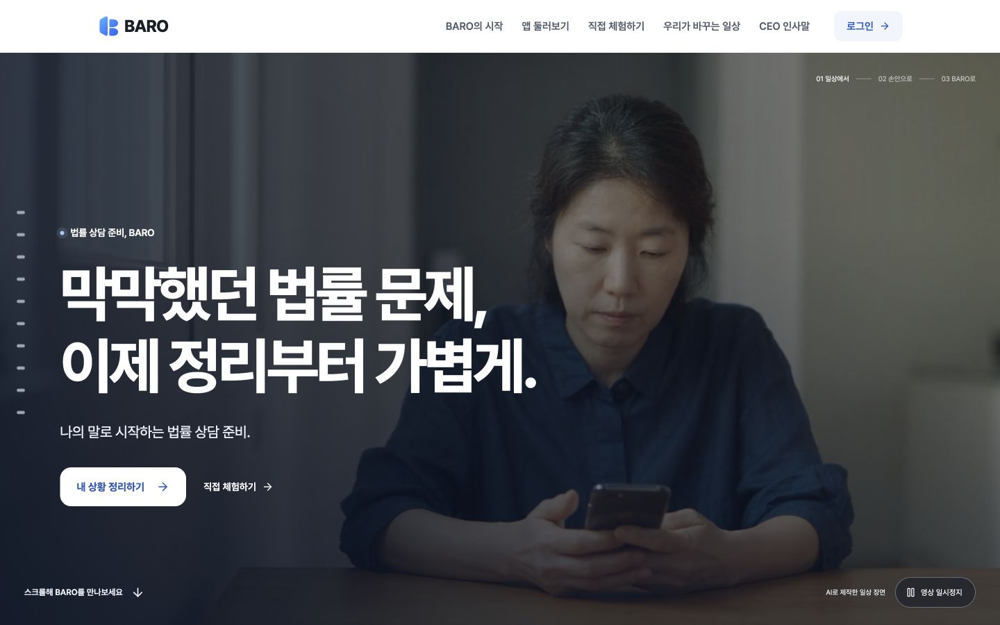
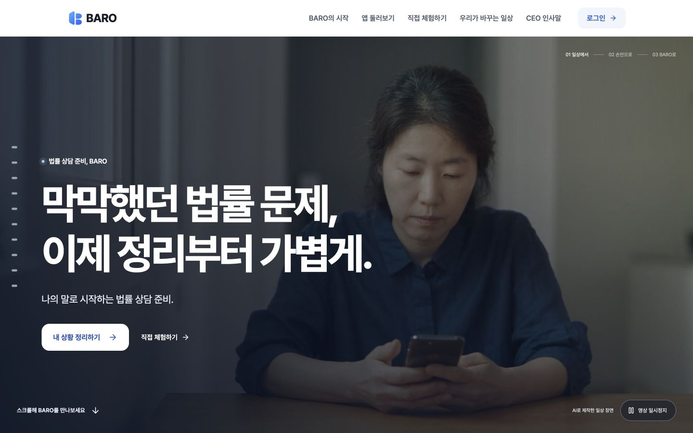
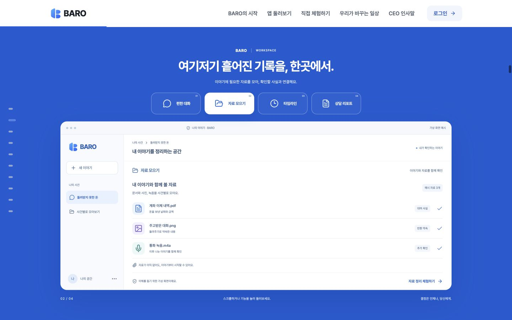
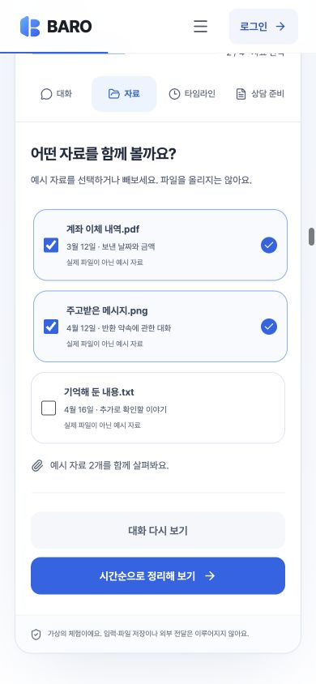
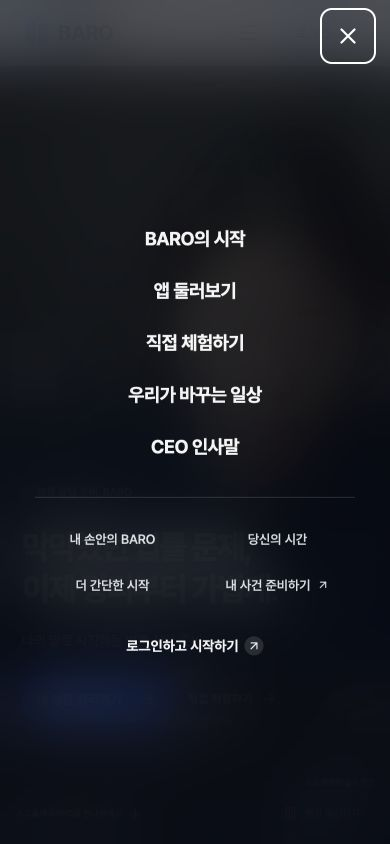
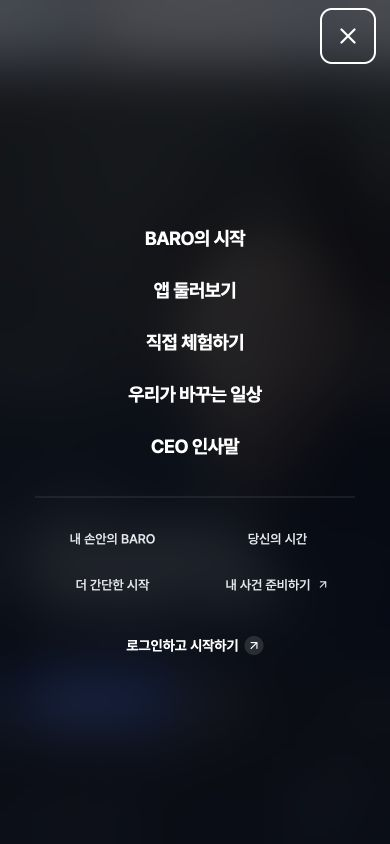
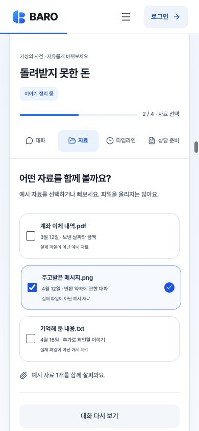
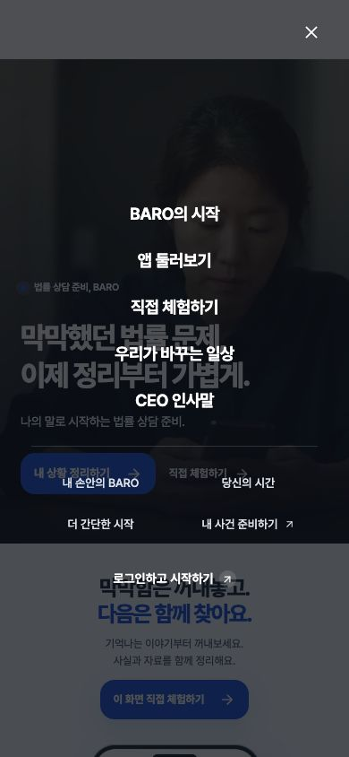
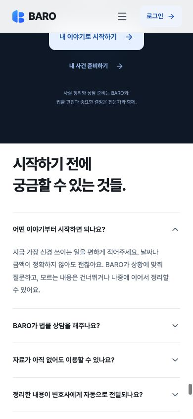
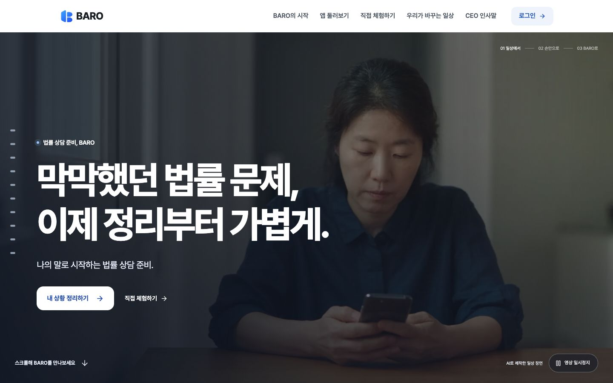

# 랜딩 디자인 이식 검증

2026-11-16 KST. 새 Astro/React/Headless UI/Tailwind 구현을 원본 랜딩과 비교했다.
원본 설계 계약은 [WEB-LANDING-PRESERVATION](../../development/WEB-LANDING-PRESERVATION.md),
실제 새 진입점은 [LandingPage](../../../src/product-ui/landing/LandingPage.astro)다.

## 기준과 범위

원본 캡처 기준은 [27a09b10](https://github.com/creno-va/baro/tree/27a09b10b9d51192bb534fbdcd07ff0214031352)이다.
해당 랜딩은 [원본 설계 조사 SHA](https://github.com/creno-va/baro/blob/b54566f32d2d81f9c08ebc26acac0209623d3af1/src/pages/index.astro)의
문안·장면·에셋을 유지한 상태였다. 아래 원본 비교·캡처·실제 빌드 검증은 `8c642ea1` 기반의 첫 랜딩 이식에서 수집했다.

현재 검토 브랜치는 전체 새 UI를 함께 검토하도록
[PR 815 기준 b5138bbf](https://github.com/creno-va/baro/tree/b5138bbf1ba2c2f99fe5aec9c0058968de0e9868) 위에 통합했다.
`27a09b10`은 원본 디자인 캡처 기준이고 `8c642ea1`은 첫 랜딩 이식의 실행 기반이며, 현재 브랜치 기반과 구분한다.
통합 HEAD의 전체 검증은 별도로 기록하며 기존 캡처를 통합 HEAD에서 새로 촬영한 증거로 표현하지 않는다.

Pinned Node24.22.1/Bun1.4.0, Astro7.3.5, 로컬 합성 UI 모드를 사용했으며 실제 사건·로그인·동의 제출이나
외부 공급자 호출은 수행하지 않았다. Computer Use 전용 Chrome 탭에서 비교했고 종료 시 탭·뷰포트·서버를 정리했다.

[계산값 비교](metrics.json)는 두 화면 크기의 16개 주요 장면을 포함한다.

| 화면 | 원본/새 문서 높이 | 헤더 | 가로 넘침 | 제목 계산값 |
| --- | --- | --- | --- | --- |
| 1440×900 | 39,392px / 39,392px | 76px | 0px | 16개 모두 일치 |
| 390×844 | 34,959px / 34,959px | 66px | 0px | 16개 모두 일치 |

제목 비교 항목은 크기·굵기·행간·자간·색상이다. 장면 위치·높이 차이는 원본 기록의 정수 반올림 범위(≤0.5px)였다.
본문 기본 글꼴과 body 색상도 일치했다. 320×500의 정적 hero/clarity 대체 구성과 640×360 메뉴도 확인했다.
원본 `public/landing`, `public/brand`, `public/fonts` 파일은 변경하지 않았다.

## 대표 화면

| 원본 첫 화면 | 새 첫 화면 |
| --- | --- |
|  |  |

영상은 같은 파일의 서로 다른 재생 시점이다. 정지 이미지 차이를 프레임 동등성으로 판단하지 않는다.

| 새 작업 공간 장면 | 새 모바일 체험 |
| --- | --- |
|  |  |

| 원본 모바일 메뉴 | 새 Headless 모바일 메뉴 |
| --- | --- |
|  |  |

## 실제 확인한 동작

전체 섹션을 스크롤하며 각 장면을 캡처했다. 파란 화면 4개 탭, 로고 6개 기능과 올바른 체험 탭·제목 포커스 이동,
체험의 3개 예시·답변·자료 선택·타임라인 disclosure·요약 수정·두 검토 확인·완료·재시작·Home 키 탭 이동을 조작했다.
휴대전화의 단계, 시계 사진, 일상 사진 3개, 두 CEO 사진과 편지, 일상 영상 재생, FAQ와 마지막 화면·정책 링크를 확인했다.
일부 즉시 캡처는 스크롤 전환 중이며 전체 모션 타이밍의 증거로 사용하지 않는다.

모바일 메뉴는 390×844·320×500·640×360에서 전체 화면, 배경 inert/스크롤 잠금, 정방향·역방향 포커스 순환,
Escape 닫기·트리거 복귀, 실제 앵커 도착을 확인했다. 최종 새로고침의 브라우저 warning/error 목록은 비어 있었다.
전체 원본 95개 캡처와 새 표본 84개는 각각 `/private/tmp/baro-landing-baseline-27a09b10`,
`/private/tmp/baro-landing-port-8c642ea1`의 로컬 임시 조사 자료다. PR에는 위 대표 파일과 계산값만 포함한다.

## 수정과 테스트 계약

유틸리티 분리 뒤 보고서 안내 섹션에 생긴 60px 차이는 padding shorthand 캐스케이드를 복원해 수정했다.
헤더 진행률과 구간 `aria-current`는 Navigation island의 mount effect 이후 시작하도록 옮겨 hydration 전 외부 변경을 없앴다.
JS 도착 전 사용자가 연 native details의 `open`은 브라우저 소유이므로 그 fallback 한 노드만 hydration 경고를 억제한다.
이 fallback은 JavaScript 없이 실제 summary와 링크를 제공하며, enhancement 시 그 내부 포커스는 새 트리거로 이어진다.

[기존 브라우저 회귀](../../../tests/browser/landing.e2e.ts)의 native `open`/`:modal` 검사는 Headless의
`role=dialog`·`aria-modal=true`·실제 배경 inert 검사로 바꿨다. 포커스 순환·Escape·스크롤 잠금·전 화면 치수·반응형·Axe와
JS 비활성 native 메뉴 계약은 유지했다. 스크립트를 지연한 상태에서 native 링크 포커스와 enhancement 후 트리거 복귀 검사도 추가했다.
[SSR 검사](../../../tests/product-ui-landing.test.tsx)는 네 단계의 읽을 수 있는 대체 화면, 실제 링크, 영상 URL 지연,
실제 휴대전화 면 구조, 인라인 실행 속성 부재와 추출한 Tailwind 유틸리티 생성을 확인한다.

첫 랜딩 이식에서 측정 수정·비활성 원본 삭제·회귀 이관을 반영한 런타임 소스의 전체 `validate:quick`과 `validate:build`를 다시 통과했다.
의존성 버전과 lock은 변경하지 않았다. `package.json`은 현재 단계 검사를 가리키는 `product-ui:check`와
`product-landing:check` 검사 별칭 두 개만 갱신하며, 새 검사기·도구 테스트 결과는 별도로 검증한다.
최종 SHA의 CI 결과는 PR 검증 기록을 기준으로 한다.

## 최종 빌드와 스크립트 차단 대체 화면

삭제·정리를 마친 실제 production build를 로컬 Worker로 열어 Computer Use로 확인했다.
[실제 빌드 결과](built-runtime.json)에서 데스크톱39,392px·모바일34,959px과 가로 넘침0을 다시 확인했다.
정상 production CSP 아래 Headless 메뉴의 `aria-modal`, 배경 inert, 키보드 순환·Escape·포커스·스크롤 복귀,
로컬 체험 답변과 자료 선택이 동작했고 정상 런타임 console warning/error는 `[]`였다.

JavaScript 비실행 대체 화면은 임시 로컬 프록시에서 동일한 built HTML·에셋을 전달하면서 두 번째 enforcing CSP로
`script-src 'none'`·`script-src-elem 'none'`·`script-src-attr 'none'`만 추가해 검사했다.
[정책·HTML 해시 증거](nojs-policy.json)에 원본 CSP와 캐시 헤더를 함께 남겼다. 원본 HTML bytes와
production CSP·`style-src`·제품 코드는 변경하거나 완화하지 않았다. 차단 화면의 의도된 CSP script denial은
위 정상 런타임의 빈 console 목록과 구분한다. 브라우저 전역 JavaScript 설정을 변경한 시험은 아니다.

| 스크립트 차단된 native 메뉴 | 스크립트 차단된 native FAQ |
| --- | --- |
|  |  |

native summary 열기·닫기, FAQ 펼치기, 실제 앵커 도착과 네 단계의 읽기용 체험을 확인했다.
고정 summary는 실제 포인터로 눌렀으며, 도착 후 닫아도 스크롤 위치가 유지됐다.
hydration 완료 클래스와 interactive demo는 없었고 영상 `src`도 설정되지 않았다.
모든 소유 탭·뷰포트·Worker·프록시를 정리했다.

스크립트를 나중에 release해 hydration과 사용자 포커스 handoff를 함께 검증하는 blocked-scripts 시나리오는
이번 CUA에서 실행하지 않았다. 해당 회귀의 소스·포커스 검사는 유지했으며 CI 실행 범위와 구분한다.
전체 프레임의 픽셀 동등성, 새 브라우저 reduced-motion 검증, 모든 경계 폭, 실제 공급자 통합 또는 배포 완료를 주장하지 않는다.

## PR 815 위 통합 브랜치 최종 점검

검증 당시 HEAD는 `ff2d43e7`이며, PR 815 기준 `b5138bbf` 위에 통합한 런타임과 고정된 계획·검사기 최종 수정을 포함했다.
랜딩 production 소스는 첫 이식 `5dc41edb`와 byte diff가 없음을 확인했다. 통합 소스의 `validate:quick`·`validate:build`는
모두 exit0였고, 현재 단계의 `product-ui:check`도 최종 증거 파일을 포함한 116개 변경 경로를 통과했다. 최종 커밋 SHA의 CI는 PR에서 별도로 기록한다.

[통합 실제 빌드 점검 결과](integrated-spotcheck.json)는 1440×900·390×844 첫 화면, Headless 메뉴의
modal/inert·포커스 순환·Escape 복귀, 익명 로그인 화면과 `/new` 경계를 포함한다. 화면 높이는39,392px·34,959px,
가로 넘침은0이었고 데스크톱·모바일·로그인·`/new`의 console warning/error 목록은 모두 `[]`였다.
익명 `/new`는 로컬 Worker의 닫힌 베타 설정에 맞는 안내를 표시했다. 실제 OAuth·정책 동의·사건 제출은 수행하지 않았다.

| 통합 빌드 1440×900 | 통합 빌드 390×844 |
| --- | --- |
|  |  |

[통합 모바일 메뉴](integrated-mobile-menu.png)와 [익명 사건 시작 경계](integrated-anonymous-new.png)도 기록했다.
기존 전체 장면 비교와 차단 프록시 검증을 반복하지 않은 간단 점검이며, 지연 hydration release의 미실행 범위도 그대로다.
전용 탭을 닫고 뷰포트를 복구했으며 Worker를 종료한 뒤 소유 포트의 listener가 없음을 확인했다. runtime 소스는 추가 변경하지 않았다.
