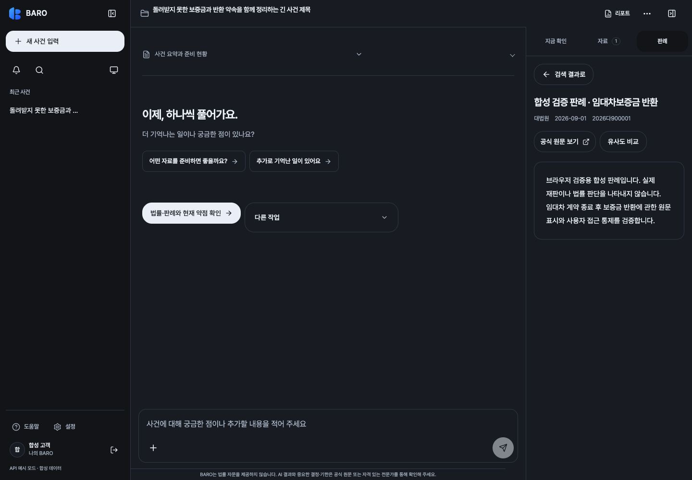
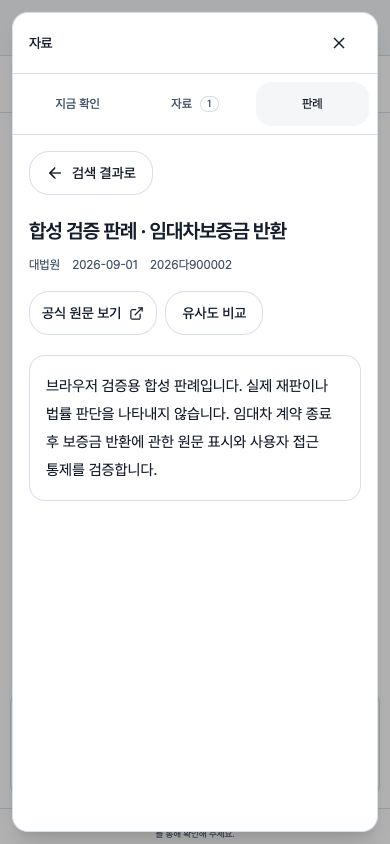

# 자료·판례 화면 검토

기준: #817 `f82400cf9966c7daecbef5b1275f4b3642be7506`. 이 기록은 로컬 합성 화면과 코드/계약 검증을 구분한다. 정확한 제출 head와 CI 결과는 PR 본문에 기록한다.

## 보존 검토

- 판례 research 7,929 UTF-8 bytes와 파생336 bytes, 비교7,204와 파생896 bytes, 조회1,472 bytes의 controller 구간을 그대로 이동했다. 주요 호출25+20개, disabled13·checked2·click9·change1과 조회 schema/attempt/mounted/ACK를 독립 비교했다.
- 첨부 upload2,356 UTF-8 bytes, picker2,081 bytes와 local key288/preview effect270 bytes를 보존했다. 기능 AST의 native input/ref/accept/multiple/capture/disabled/key/ARIA/callback/URL 차이는0이다. 기존 `useEvidenceUpload.ts`는 수정하지 않았다.
- [판례 AST 증거](./research-ast-proof.json), [첨부 AST 증거](./evidence-ast-proof.json). 기존 source snapshot·독립 검토와 집중 테스트를 함께 사용했다. 단순 byte 동등성만으로 UI 인수를 대신하지 않는다.
- `product-ui:check`는 이 단계의 API·DB·계약·공유 client·assets·dependency/lock·기존 기능 회귀 단언을 보호한다. CSS import/route1줄, resolver owner경로와 실제 selector consumer의 exact patch만 허용한다.

## 실제 Astro mock Computer Use

`BARO_UI_TEST_FIXTURE=true PUBLIC_API_MODE=mock`, localhost4368. visible 개발 전용 버튼으로 합성 계정/사건을 준비했다. 실계정 로그인·정책 동의·외부 공급자 요청은 수행하지 않았다.

- 사건 참고 패널과 독립 `/cases/shell-app-case/precedents`에서 추천2주제·최대2개 제한·다른 주제 disclosure·주제 변경 후 검색을 확인했다.
- 합성 판례2건의 출처/법원/날짜/사건번호, 원문 표시, 선택 후 제목 focus와 결과 복귀 시 동일 opener focus를 확인했다. 공식 링크의 HTTPS/새 창/`noopener noreferrer`는 DOM으로 확인했고 링크를 열지 않았다.
- 비교 요청은 기본 mock의 미지원 상태에서 오류/재시도 안내를 표시했다. 외부 조회는 catalog를 받지 못한 안내와 닫기만 표시했다. 이를 실제 비교나 조회 성공으로 기록하지 않는다.
- 1440px dark의 좁은 참고 패널에서 제목이 압축되는 문제가 있어 비교 헤더를 단일 column으로 수정했다. 수정 후 제목 영역312px·높이60px로 읽을 수 있고 본문/버튼을 분리했다.
- 390px light 자료 dialog의 판례 원문·닫기 복귀, 320px 독립 화면과 조회 dialog의 가로 넘침 없음을 확인했다. 페이지 scrollWidth가 viewport와 같다. 콘솔 warning/error는0이다.
- [geometry·상태](./metrics.json), [콘솔](./console.json). 모든 root 탭과 viewport override는 정리했다.

## 첨부 검토와 한계

별도 Chrome에서 같은 실제 Astro mock을 확인했다. 1440px 자료 목록·부분 coverage/관찰 검토, 수정 후 닫기에서 ‘계속 작성’으로 초안 유지, 390/320px 검토 화면과 자료 확인→패널 닫기→자료 열기의 포커스 복귀를 확인했다. 원본 binary가 없는 합성 자료는 NOT_FOUND 안내를 표시했다. [상세 기록·사진](./evidence/README.md), [확정된 관찰](./evidence/metrics.json).

파일 선택기 이벤트·클릭·파일 지정 호출은 반환되지 않아 중단했다. 어느 내부 단계가 끝났는지 확정할 수 없으며, 이 Computer Use에서 선택·첨부·업로드 성공 또는 제거 버튼44px 실측을 주장하지 않는다. 콘솔 조회도 수행하지 못했다. 준비된 synthetic account와 기존 파일 검토까지만 실제 화면 증거다. 탭 종료·viewport reset·개발 서버 종료는 확인했다.

새 native chooser/ref/disabled/capture·처리 동의·부분 coverage·preview/제거 callback은 집중 SSR·기존 업로드 회귀와 독립 AST 검사를 통과했다. 미검증된 실제 선택기·원격 처리와 이 증거를 구분한다. 기본 mock에 없는 비교 결과·조회 동의 상태도 SSR/원본 계약 테스트 및 해당 PR의 법률 회귀 CI로 별도 기록한다.

## 실행한 검사

- 새 evidence/research/보존/실제 fixture resolver 47 tests, 497 assertions 통과.
- 앱·tools TypeScript, 보존 가드, 문서 검사 통과. API·DB·shared client·assets·dependencies/lock 변경 없음.
- `validate:quick`, `validate:build` 통과. production bundle·Worker dry-run·anonymous login/protected shared503 built-runtime을 확인했다. 기존 Docker 의존4개 로컬 skip은 전체 성공으로 승격하지 않는다. 원격 CI의 실제 결과는 PR 본문에 확정한다.
