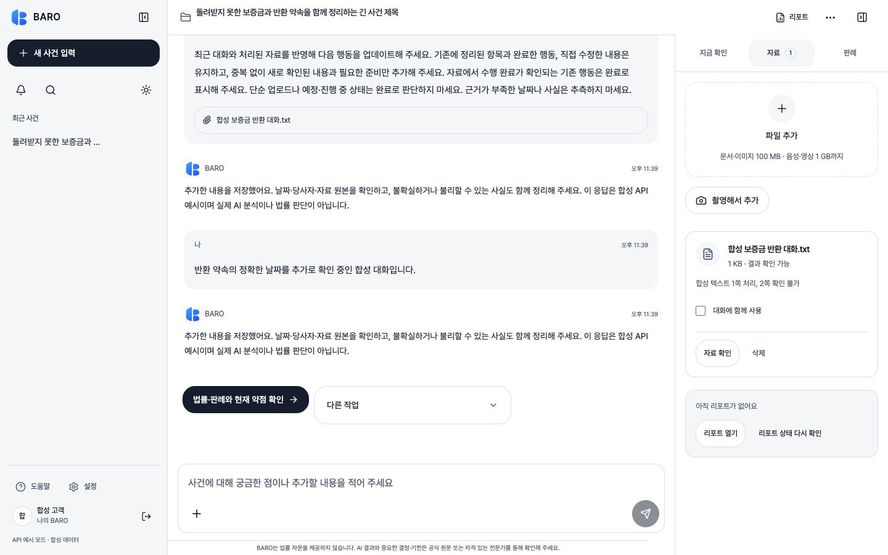
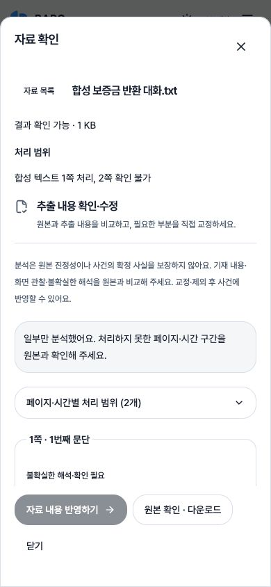

# 통합 제품 화면 검토

#818 위에 Workspace·공개/인증·v1·재생기·공통 확인창을 연결했다. 정확한 제출 head/기준과 원격 CI 링크는 PR 본문에 기록한다. 구현 범위는 [PRODUCT-SURFACES](../../development/PRODUCT-SURFACES.md)를 참조한다.

## 원문과 기능 보존

- Workspace 네 구간 각각 UTF-8 21,218 / 1,208 / 16,681 / 1,022 bytes 동일. API24·owner/I/O99호출과 disabled42/checked4/IDs/keys/refs·native 이벤트 및 옮긴 history/original/retry/delete closure를 대조했다. JSX·표현 factory·v1 early return은 명시적 분리 경계다. [증거](./workspace-proof.json).
- v1 case7,849/questions1,153/result analytics592/feedback1,329 bytes 동일. API/analytics14호출, 기존 답변/출처/에러·Unicode·동일 요청/ACK·삭제 제어를 대조했다. [코어](./legacy-core-proof.json), [AST](./legacy-ast-proof.json). 상태 문구는 이전 CaseList 전체 runtime 의존성을 끌어오지 않는 순수 presentation module로 옮기고 compatibility export를 유지했다.
- 재생기 controller3,764 bytes, clock/initial453 bytes, Range core370 bytes 동일. decoder11events·Range4handlers·mute/rate/reload·native refs/props를 대조했다. [증거](./playback-proof.json).
- Auth762 bytes, Consent2,484 bytes의 원래 core와 기능 속성을 독립 비교했다. 정책 데이터 SHA256 `1771ed38f0c3d891bffb33734868f82af416c770b370acf9aaaba24f3b673ef0` 유지, OAuth 오류 분기·404/410·ai-notice302·CSP/bootstrap/cache/skip/main 계약 유지.
- 공통 확인 store/effect1,219 bytes 동일. [증거](./experience-proof.json). pending source/route/session 취소를 유지하며 자동 승인하지 않는다.
- public/v1/playback에 독립 검토를 수행했고, v1 Field 이름 문제를 수정했다. [Field 이름 스캔](./field-name-audit.json). 정적 속성 비교와 SSR만으로 hydration 접근성을 판정하지 않는다.

## 실제 Astro mock Computer Use

localhost4369, `BARO_UI_TEST_FIXTURE=true PUBLIC_API_MODE=mock`. 개발 전용 visible 버튼만 합성 세션을 준비했다. 실제 OAuth·정책 동의 제출·삭제·외부 공급자·운영 DB는 사용하지 않았다.

- 로그인 callback 오류, provider3개와 320px 배치, theme menu를 확인했다. 버튼56px, 가로 넘침0. provider sign-in은 누르지 않았다.
- 도움말 FAQ를 키보드로 펼쳤고, privacy 전체8섹션/버전·시작 CTA·404/410 안내와 복귀를 확인했다. 문구의 법률 검토/운영 인수를 뜻하지 않는다.
- `needsConsent=true` 합성 fixture에서 초기 unchecked/submit disabled → 체크 후 enabled → 다시 unchecked를 확인했다. 제출하지 않았다.
- 모바일 타임라인 sheet x0/width390/bottom844. 연도만 입력한2025 일정을 저장하고 ‘월·일 미상’을 확인했다. 닫기는 원래 opener로 복귀했다. 미저장 timeline의 닫기는 기존 discard 동작이며 새 보호 기능을 검증했다고 기록하지 않는다.
- 자료 교정의 dirty-close 확인은 취소 초기 focus → Escape → 동일 초안과 닫기 opener 복귀를 확인했다. 실제 mock 교정 저장 뒤 파일v2/반영 버튼 재활성을 확인했다.
- 자료 footer: 390 light/320 dark에서 opaque·sticky·패널 padding-bottom0, 버튼 높이44px. 320px 실제 scrollTop0/380/588에서 세 샘플 모두 하단을 덮었고, 끝의 마지막 본문 bottom599.3 < footer top615로 가림 없음을 확인했다.
- 행동 refresh의 busy→완료와 생성된 행동0을 확인했다. 대화의 합성 user/pending/완료 reply와 reload 읽기, 1440/320 입력창·반응형을 확인했다. 합성 응답을 실제 AI/법률 결과로 표현하지 않는다.
- 자료 추가의 icon/문구가 primary 배경과 섞여 읽기 어려운 점을 secondary variant로 수정·reload 확인했다. 최종 light hint RGB82/97/118, 배경255/255/255·아이콘23/32/51로 분리된다.
- [geometry/여정](./browser/metrics.json), [콘솔](./browser/console.json). root의 console warning/error0. 브라우저 탭/viewport와 Astro daemon 종료를 확인했다.

## 실제 원본 재생과 v1 별도 HTTP 검증

동일 Astro의 기존 `/__media-player` fixture에서 WAV20초·MP48초 decode, 실제 play/pause·keyboard Home/Arrow/End·pointer10초·음소거/볼륨·1.5배, 잠금 시 pause/해제 후 자동 resume 없음, play 중 unmount를 확인했다. 390/320 가로 넘침0·제어44px, 콘솔0. 배속 이름을 수정한 뒤 exact role ‘재생 속도’와 native playbackRate1.5를 다시 확인했다. fullscreen은 브라우저가 요청을 거절해 기존 실패 안내까지만 확인했다. [별도 재생 기록](./playback/QA.md), [geometry/상태](./playback/metrics.json).

v1은 raw native fetch를 유지하므로 기본 Astro mock이 해당 endpoint를 대신하지 않는다. 별도 localhost4380 HTTP harness에서 실제 CaseDetail과 shared schema 합성6UUID만 응답했다. 다른 경로404·DELETE405, auth/DB/외부 IO가 없다. 결과·근거 anchor/체크·평가 ACK, 질문 text+unknown/답변 ACK·결과 focus, 실패/재시도 ACK, 지원 범위/긴급/진행 상태를 확인했다. 초기 Vite glob 의존 오류를 순수 status import로 해결하고 새 탭 console0을 확인했다.

번호가 사라지던 textarea label을 수정하고 실제 `getByRole(textbox, name='1번 답변', exact=true)` 입력을 다시 확인했다. 이 재확인은 `.case-shell` ancestor도 포함하며320px scrollWidth320이다. [최종 이름/배치](./legacy/name-final.json), [최종 콘솔](./legacy/console-name-final.json). 실제 legacy auth/운영 persistence 인수로 표현하지 않는다. 모든 별도 서버/탭도 종료했다.

## 남은 외부 조건과 검증 구분

파일 선택기 도구가 이전 #818 CUA에서 반환되지 않아 실제 첨부/업로드 성공은 이 기록에 포함하지 않는다. 원격 OAuth/AI/조회·R2/native 출력·fullscreen·운영 D1 지연·배포도 해당 조건의 별도 증거가 필요하다. 기존 controller/native props·서버/클라이언트 회귀와 실제 화면 검증 범위를 구분한다.

25 production Astro roots에서 상대 static/reexport/literal dynamic/Astro script 경로310 modules를 독립 조사했고, 이전 UI control subtree의 active import0을 확인했다. [graph](./active-graph.json). Base/App/PublicLayout과 ToolResults는 현재 production graph에서 도달하지 않는다. BrandMark와 downloadLawyerAsset는 asset/business helper만 사용한다. 공통 case-notice, 폰트·테마·포커스·geometry·문서/print·scoped compatibility CSS가 남으며 전체 CSS 삭제를 주장하지 않는다. 랜딩/자산·API/DB·공유 클라이언트는 이 UI 단계에서 바꾸지 않았다.

최종 통합 `validate:quick`, `validate:build` 통과. Astro705개 파일 errors0/warnings0, 앱/tools·모바일/공유 계약·기존 회귀, production bundle·Worker dry-run·anonymous login/protected shared503 built-runtime을 확인했다. 새 UI/실제 resolver/consent/name 검사는67 tests·698 assertions, fixture 문구/보존/이름 보강40 tests·281 assertions를 별도로 통과했다(중복 검사를 합산하지 않음). 보존 가드도 통과했다. 기존 Docker 의존4개 로컬 skip은 실제 native 성공으로 승격하지 않는다. Biome은 exit0이며 전역213 warnings/55 infos를 오류와 구분해 기록한다. 정확한 제출 head의 원격 CI 결과는 PR 본문에 확정한다.
